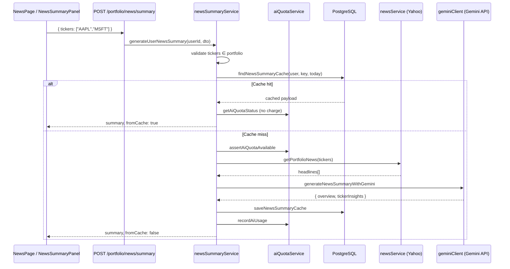
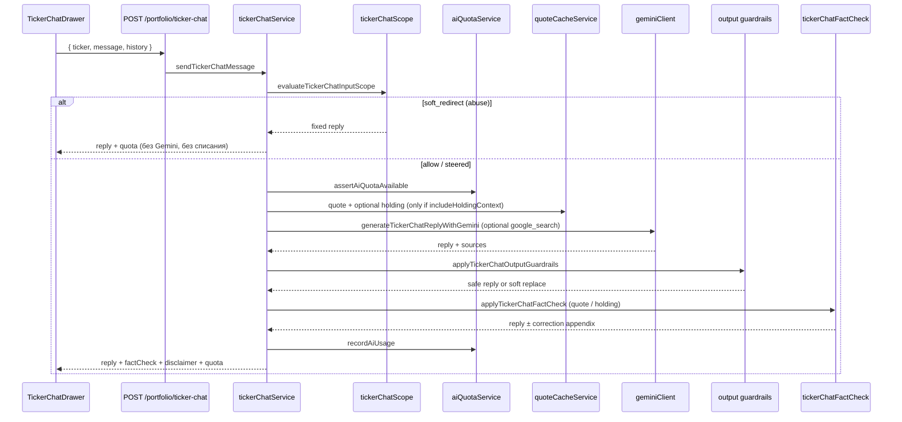

# Интеграция AI (Gemini)

Документ описывает AI-фичи платформы Krepton Analytics на базе Gemini:

1. **News Daily Briefing** (§1–13) — ежедневный саммари новостей по выбранным тикерам портфеля.
2. **Ticker AI Chat** (§18) — чат на странице тикера с продуктовыми guardrails (scope + output check).

Общие принципы: API key только на backend, минимум PII в промптах, единый gateway `geminiClient.ts`, квоты через `ai_usage_events`.

---

## 1. Обзор фичи (News Daily Briefing)

**Что делает пользователь:**
1. Открывает страницу `/news`.
2. Выбирает от 1 до 5 тикеров из своих текущих holdings.
3. Нажимает «Generate today's summary».
4. Получает **AI market briefing**: блоки по каждому тикеру (цена, % за день, sentiment, highlights), макро-драйверы рынка и опционально контекст позиции (shares / avg buy / P&L).

**Что делает система:**
1. Проверяет, что тикеры принадлежат портфелю пользователя.
2. Ищет готовый summary в PostgreSQL-кэше за сегодня (ключ учитывает версию briefing, portfolio context и grounding).
3. Если кэша нет — проверяет дневную квоту, собирает контекст (котировки, macro tickers, Yahoo headlines), отправляет в Gemini, сохраняет результат и списывает 1 запрос из лимита.
4. Возвращает JSON с disclaimer, sources (если grounding) и актуальным состоянием квоты.

**Текущая версия (v2 briefing):** enriched context без grounding работает на free tier. **Google Search grounding** — opt-in через `GEMINI_GROUNDING_ENABLED=true` после привязки billing card в AI Studio (до демо держим `false`).

---

## 2. Принципы архитектуры

| Принцип | Реализация |
|---|---|
| API key только на backend | `GEMINI_API_KEY` в `.env`, никогда не уходит на frontend |
| Минимум PII в промпт | В Gemini передаются только тикеры + заголовки/источник/дата публикации |
| Один gateway к Gemini | Все вызовы через `geminiClient.ts` |
| Квота per user | Таблица `ai_usage_events`, лимит в `constants.ts` |
| Кэш per user per day | Таблица `ai_news_summaries`, повтор не тратит квоту |
| Clean Architecture | Route → Controller → Service → Repository |
| Без magic values | Все лимиты и строки — в `backend/src/constants.ts` |

---

## 3. Схема потока данных



---

## 4. Структура файлов

### Backend

```
backend/src/
├── config/env.ts                          # GEMINI_API_KEY, isGeminiConfigured
├── constants.ts                           # лимиты, модель, rate limit, disclaimer
├── types/ai.types.ts                      # TypeScript-контракты API
├── repositories/aiRepository.ts             # SQL: кэш + usage events
├── services/
│   ├── geminiClient.ts                    # HTTP-клиент Gemini, prompt v2, optional grounding
│   ├── briefingContextService.ts          # quotes, macro, headlines, portfolio context
│   ├── aiQuotaService.ts                  # дневная квота per user
│   ├── newsSummaryService.ts              # бизнес-логика фичи
│   └── newsService.ts                     # Yahoo headlines (переиспользуется)
├── controllers/portfolioController.ts     # getNewsSummaryQuotaHandler, postNewsSummaryHandler
├── routes/portfolioRoutes.ts              # маршруты + rate limiters
└── migrations/1751370009000_create-ai-news-summary-schema.js
```

### Frontend

```
frontend/src/
├── types/ai.types.ts
├── api/portfolioApi.ts                    # fetchNewsSummaryQuota, generateNewsSummary
├── constants.ts                           # AI_NEWS_SUMMARY_MAX_TICKERS = 5
└── pages/NewsPage/
    ├── NewsPage.tsx
    └── components/NewsSummaryPanel/
        ├── NewsSummaryPanel.tsx
        └── NewsSummaryPanel.module.scss
```

---

## 5. Конфигурация

### 5.1. Переменные окружения

Добавить в `backend/.env`:

```env
GEMINI_API_KEY=your_key_from_google_ai_studio

# Google Search grounding — только после billing card в AI Studio. До демо держать false.
GEMINI_GROUNDING_ENABLED=false
```

Ключ получается бесплатно: [Google AI Studio](https://aistudio.google.com/apikey).

Шаблон также есть в `backend/.env.example`.

### 5.2. Grounding и billing (консервативный режим)

| Режим | `GEMINI_GROUNDING_ENABLED` | Что получает пользователь |
|---|---|---|
| **Default (до демо)** | `false` | Котировки + macro (SPY, QQQ, CL=F, ^VIX) + Yahoo headlines → Gemini без Google Search |
| **После billing card** | `true` | То же + live web search через `tools: [{ google_search: {} }]`. URL-списки в UI не показываем |

**Чеклист перед включением grounding:**

1. Привязать billing card в [Google AI Studio](https://aistudio.google.com/) → Billing.
2. Установить **Project Spend Cap** ($5–10 достаточно для дипломного POC).
3. В `backend/.env`: `GEMINI_GROUNDING_ENABLED=true`, перезапустить backend.
4. Один тестовый briefing на `/news` — проверить badge «Web search» (без блока Sources).
5. Мониторить usage в AI Studio; app-level лимит 3/day/user остаётся.

Без карты grounding **не включаем** — Gemini 3.x search grounding требует paid tier; free tier продолжает работать с enriched context.

### 5.3. Проверка конфигурации

В `backend/src/config/env.ts`:

```ts
geminiApiKey: optionalEnv('GEMINI_API_KEY', ''),
export const isGeminiConfigured = env.geminiApiKey.length > 0;
export const isGeminiGroundingEnabled = env.geminiGroundingEnabled;
```

Если ключ не задан, `geminiClient` вернёт **503** с сообщением `AI summarization is not configured on the server.` — UI покажет его пользователю.

Grounding включается только если **и** env flag `true`, **и** runtime передаёт `groundingEnabled` в контекст (сейчас = env flag).

### 5.4. Константы (backend)

| Константа | Значение | Назначение |
|---|---|---|
| `AI_NEWS_SUMMARY_MAX_TICKERS` | 5 | Максимум тикеров в одном запросе |
| `AI_NEWS_SUMMARY_MIN_TICKERS` | 1 | Минимум тикеров |
| `AI_NEWS_SUMMARY_FREE_DAILY_LIMIT` | 3 | Запросов к Gemini в день на пользователя |
| `GEMINI_MODEL` | `gemini-3.8-flash` | Одна модель на все AI-вызовы. Стабильный Flash выше 3.6 |
| `GEMINI_THINKING_LEVEL` | `low` | Минимум для 3.8: thinking-токены входят в maxOutputTokens |
| `GEMINI_MAX_OUTPUT_TOKENS` | 8192 | Потолок briefing JSON вместе с thinking-токенами |
| `GEMINI_REQUEST_TIMEOUT_MS` | 30 000 | Таймаут без grounding |
| `GEMINI_GROUNDING_REQUEST_TIMEOUT_MS` | 90 000 | Таймаут с Google Search grounding |
| `AI_BRIEFING_CACHE_VERSION` | `v2` | Версия cache key — инвалидирует v1 кэш |
| `AI_BRIEFING_MACRO_TICKERS` | SPY, QQQ, CL=F, ^VIX | Macro context для «почему рынок двигался» |
| `AI_NEWS_SUMMARY_RATE_LIMIT_MAX_REQUESTS` | 10 / 15 min | Express rate limit на endpoint |

> **Pro-план (будущее):** сейчас все пользователи на free-лимите (`AI_NEWS_SUMMARY_FREE_DAILY_LIMIT`). Для Pro достаточно расширить `getDailyLimitForFeature()` в `aiQuotaService.ts` — проверять tier пользователя в БД.

---

## 6. API

Все endpoint'ы требуют JWT в HttpOnly cookie (`authMiddleware`).

Базовый prefix: `/api/portfolio` (см. `API_ROUTES.PORTFOLIO`).

### 6.1. GET `/news/summary/quota`

Возвращает остаток дневной квоты.

**Response:**

```json
{
  "success": true,
  "data": {
    "used": 1,
    "limit": 3,
    "remaining": 2,
    "resetsAt": "2026-07-23T00:00:00.000Z"
  }
}
```

`resetsAt` — полночь UTC следующего дня.

### 6.2. POST `/news/summary`

Генерирует (или отдаёт из кэша) summary.

**Request body:**

```json
{
  "tickers": ["AAPL", "MSFT", "NVDA"],
  "includePortfolioContext": false
}
```

`includePortfolioContext` (optional, default `false`): если `true`, в промпт и UI попадают shares, avg buy price и unrealized P&L — только для выбранных тикеров. По умолчанию анонимный режим (только ticker + market data).

**Response:**

```json
{
  "success": true,
  "data": {
    "summaryDate": "2026-07-22",
    "tickers": ["AAPL", "MSFT", "NVDA"],
    "holdingInsights": [
      {
        "ticker": "AAPL",
        "companyName": "Apple Inc.",
        "price": 214.5,
        "changePercent": 1.2,
        "sentiment": "bullish",
        "summary": "Apple moved higher on ...",
        "highlights": ["...", "..."],
        "shares": null,
        "avgBuyPrice": null,
        "unrealizedPnlPercent": null
      }
    ],
    "marketDrivers": [
      { "title": "Rates & macro", "summary": "..." }
    ],
    "sources": [
      { "title": "Reuters", "url": "https://..." }
    ],
    "disclaimer": "AI-generated summary for informational purposes only. Not financial advice.",
    "fromCache": false,
    "groundingEnabled": false,
    "includePortfolioContext": false,
    "quota": {
      "used": 1,
      "limit": 3,
      "remaining": 2,
      "resetsAt": "2026-07-23T00:00:00.000Z"
    }
  }
}
```

`sources` заполняется только при `groundingEnabled: true`. `holdingInsights` всегда выровнены по запрошенным tickers (missing → neutral fallback).

### 6.3. Коды ошибок

| HTTP | Когда |
|---|---|
| 400 | Невалидные тикеры, тикер не из портфеля, пустой портфель |
| 401 | Нет JWT |
| 429 | Дневная квота исчерпана |
| 502 | Gemini вернул невалидный/пустой JSON |
| 503 | Нет API key / Gemini перегружен (429) / quota или billing limit Google |

---

## 7. База данных

Миграция: `1751370009000_create-ai-news-summary-schema.js`

### 7.1. `ai_news_summaries` — кэш результатов

| Колонка | Тип | Описание |
|---|---|---|
| `user_id` | uuid FK → users | Владелец summary |
| `tickers_key` | varchar | `AAPL,MSFT|v2|ctx=0|g=0` — tickers + cache version + portfolio flag + grounding flag |
| `summary_payload` | jsonb | v2: `{ holdingInsights, marketDrivers, sources?, groundingEnabled }` |

**Unique index:** `(user_id, tickers_key, summary_date)`

Повторный запрос с тем же набором тикеров, тем же `includePortfolioContext` и тем же режимом grounding в тот же день → cache hit → **квота не списывается**.

### 7.2. `ai_usage_events` — учёт квоты

| Колонка | Тип | Описание |
|---|---|---|
| `user_id` | uuid FK → users | Пользователь |
| `feature` | varchar | `'news_summary'` (extensible) |
| `created_at` | timestamptz | Момент списания |

Запись создаётся **только после успешного вызова Gemini**, не при cache hit.

---

## 8. Логика квоты и кэша

### Алгоритм `generateUserNewsSummary`

```
1. Нормализовать tickers (uppercase, dedupe, max 5)
2. includePortfolioContext = dto flag ?? false
3. Проверить, что каждый ticker ∈ portfolio holdings
4. summaryDate = today (UTC)
5. tickersKey = "{sorted}|v2|ctx={0|1}|g={0|1}"  // g = isGeminiGroundingEnabled
6. IF cache exists for (userId, tickersKey, summaryDate):
     RETURN cached + fromCache: true  // без recordAiUsage
7. assertAiQuotaAvailable()          // throws 429 if remaining == 0
8. context = buildBriefingContext(userId, tickers, includePortfolioContext)
     // quotes, macro tickers, Yahoo headlines, optional position sizes
9. payload = generateBriefingWithGemini(context)
10. saveNewsSummaryCache(...)
11. recordAiUsage(userId, 'news_summary')
12. RETURN payload + fromCache: false
```

### Почему два уровня защиты?

| Уровень | Механизм | Защищает от |
|---|---|---|
| **Soft cap (per user)** | `ai_usage_events` + daily limit | Злоупотребление free tier одним пользователем |
| **Hard cap (per IP)** | `express-rate-limit` на POST | Burst-атаки, брутфорс endpoint'а |
| **Project cap (Google)** | Free tier Gemini (~RPD на project) | Выход за баланс Google Cloud — мониторить в AI Studio |

---

## 9. Интеграция с Gemini

### 9.1. Клиент

Файл: `backend/src/services/geminiClient.ts`

- HTTP POST через axios (без отдельного SDK — меньше зависимостей).
- Endpoint: `POST /v1beta/models/{model}:generateContent?key=...`
- Structured output: `responseMimeType: application/json` + `responseSchema` — Gemini возвращает типизированный JSON, а не свободный текст.

### 9.2. Что попадает в промпт (v2)

```
Tickers: AAPL, MSFT

Quotes:
- AAPL: $214.50 (+1.2%)
- MSFT: $420.10 (-0.4%)

Macro:
- SPY: +0.3%, QQQ: +0.5%, CL=F: -1.1%, ^VIX: 14.2

Headlines (Yahoo):
- [AAPL] Apple announces ... (Reuters, 2026-07-22T10:00:00.000Z)

Portfolio context (only if includePortfolioContext=true):
- AAPL: 10 shares @ $180.00, unrealized P&L +19.2%
```

**Не передаётся по умолчанию:** email, userId, пароли, broker data. Position sizes — только по явному opt-in пользователя.

### 9.3. Google Search grounding (optional)

При `GEMINI_GROUNDING_ENABLED=true`:

- В request body добавляется `tools: [{ google_search: {} }]`
- Prompt просит опираться на свежие web sources
- `extractGroundingSources()` парсит `groundingMetadata` → массив `{ title, url }` в ответе API
- Таймаут увеличен до `GEMINI_GROUNDING_REQUEST_TIMEOUT_MS`

### 9.4. Инструкции модели (guardrails)

- «Use ONLY the headlines provided below» (без grounding) / «Prefer cited web sources when grounding is on»
- «Do not invent events, prices, or forecasts»
- Разделять company-specific news и broader market pressure
- При отсутствии новостей — явно сказать, что coverage limited

### 9.5. Пост-обработка ответа

`parseBriefingJsonResponse()`:

- Валидирует JSON schema v2 (`holdingInsights`, `marketDrivers`)
- Нормализует sentiment → `bullish | neutral | bearish`
- Обрезает highlights до 3 пунктов
- `alignHoldingInsights()` в `newsSummaryService` дополняет missing tickers fallback-текстом и подмешивает live quotes из context

### 9.6. Обработка ошибок Gemini

| Ответ Google | Действие backend |
|---|---|
| HTTP 429 (quota/billing) | 503 «Gemini quota or billing limit reached...» |
| HTTP 429 (other) | 503 «AI service is temporarily busy» |
| HTTP 400/403 | Log + 503 «AI service is unavailable» |
| Пустой candidates | 502 «AI returned an empty response» |
| Invalid JSON | 502 «AI returned an invalid response» |

---

## 10. Связь с Yahoo Finance News

AI summary **не заменяет** ленту новостей — дополняет её.

```
newsService.getPortfolioNews(tickers)
  → Yahoo Search API (/v1/finance/search?newsCount=5)
  → in-memory cache (10 min TTL)
  → до 20 aggregated headlines
```

Эти headlines становятся input для Gemini. Если Yahoo не вернул новости — промпт явно сообщает об этом, модель формирует neutral summary.

---

## 11. Frontend

### 11.1. Компонент `NewsSummaryPanel`

Расположен на `/news` над блоком `NewsFeed`.

**UX:**
- Chips для каждого holding — click toggle (max 5 selected)
- Checkbox «Include my position sizes (shares, avg buy, P&L)» — off by default
- Badge: «2 of 3 left today»
- Кнопка Generate → loading spinner
- Результат: grid карточек holdings (price, % change, sentiment) + секция Market drivers. Исходящие URL не показываем.
- Badge «Cached today» если `fromCache: true`; «Web search» если `groundingEnabled: true`
- Disclaimer внизу

**Сброс состояния:** `NewsPage` передаёт `key={holdingsTickerKey}` — при смене состава портфеля panel remount'ится.

### 11.2. API-клиент

```ts
fetchNewsSummaryQuota()   // GET  /portfolio/news/summary/quota
generateNewsSummary({ tickers, includePortfolioContext? })  // POST /portfolio/news/summary
```

Ошибки 503 с AI-сообщениями пробрасываются через `apiError.ts` (whitelist `SAFE_SERVER_MESSAGES`).

---

## 12. Безопасность

| Риск | Митигация |
|---|---|
| Утечка API key | Key только в server env; не в git (`.gitignore`) |
| Prompt injection через headlines | Headlines из Yahoo, не от пользователя напрямую; инструкция «use ONLY provided headlines» |
| Financial advice liability | Disclaimer на каждом ответе; summary, не buy/sell рекомендации |
| Quota bypass | Cache key включает userId; auth middleware на всех routes |
| Cost overrun | Per-user daily limit (3/day) + optional Project Spend Cap при grounding |

---

## 13. Запуск и проверка

### Локально

```bash
# 1. Миграция (если ещё не применена)
cd backend
npm run migrate:up

# 2. Добавить GEMINI_API_KEY в backend/.env

# 3. Запустить backend + frontend
npm run dev   # в backend/
npm run dev   # в frontend/

# 4. Войти в аккаунт, добавить positions, открыть /news
```

### Ручной тест API (с cookie после login)

```bash
# Quota
curl -b cookies.txt http://localhost:3001/api/portfolio/news/summary/quota

# Generate
curl -b cookies.txt -X POST http://localhost:3001/api/portfolio/news/summary \
  -H "Content-Type: application/json" \
  -d '{"tickers":["AAPL","MSFT"],"includePortfolioContext":false}'
```

### Ожидаемое поведение

1. Первый запрос с `[AAPL, MSFT]` → `fromCache: false`, `quota.used` +1
2. Повтор с теми же тикерами сегодня → `fromCache: true`, `quota.used` без изменений
3. Запрос с `[AAPL, GOOG]` (другой набор) → новый Gemini call, +1 к quota
4. После 3 уникальных генераций за день → HTTP 429

---

## 14. Расширение: добавление новой AI-фичи

Шаблон для будущих фич (weekly digest, explain rebalancing):

1. Добавить `AiFeatureId` в `constants.ts` → `AI_FEATURES`
2. Определить лимит в `getDailyLimitForFeature()`
3. При необходимости — новая таблица кэша или reuse pattern
4. Новый метод в dedicated service (не раздувать `newsSummaryService`)
5. Вызов через `geminiClient.ts` или новый client method с отдельным prompt
6. Route + controller + frontend panel
7. `recordAiUsage(userId, 'new_feature')` после успеха

**Не делать:** прямые вызовы Gemini из controller или frontend.

---

## 15. Troubleshooting

| Симптом | Причина | Решение |
|---|---|---|
| «AI summarization is not configured» | Пустой `GEMINI_API_KEY` | Добавить ключ в `.env`, перезапустить backend |
| «AI service is unavailable» | Невалидный ключ / модель недоступна | Проверить ключ в AI Studio, модель `gemini-3.8-flash` |
| «Gemini quota or billing limit reached» | Grounding без billing / spend cap | Отключить grounding или привязать card + spend cap |
| «AI service is temporarily busy» / quota exhausted | Квота или биллинг Gemini | Проверить prepaid-баланс и что `GEMINI_MODEL` = `gemini-3.8-flash` |
| 500 на quota/summary | Миграция не применена | `npm run migrate:up` |
| Summary generic / empty | Yahoo не вернул headlines | Нормально для illiquid tickers; проверить `/portfolio/news` |
| Quota не сбрасывается | UTC midnight | Лимит считается по UTC, не local time |

---

## 16. Связанные документы

- [ARCHITECTURE_BACKEND.md](./ARCHITECTURE_BACKEND.md) — слои backend, error handling, security
- [ARCHITECTURE_FRONTEND.md](./ARCHITECTURE_FRONTEND.md) — структура React-приложения
- [ВозможныеФичи.md](./ВозможныеФичи.md) — roadmap модулей, включая Mod.12 (AI news summary)

---

## 17. Roadmap AI-модуля

| Приоритет | Фича | Статус |
|---|---|---|
| P0 | News Daily Briefing (v2) | ✅ Реализовано (grounding off by default) |
| P0b | Enable Google Search grounding | 🔲 После billing card → `GEMINI_GROUNDING_ENABLED=true` |
| P1 | Sentiment tags inline в ленте | 🔲 Planned |
| P2 | «Explain my alignment» на rebalancing | ✅ Реализовано (AI Insights tab; includes false-diversification check) |
| P2b | Ticker AI Chat (scoped drawer + guardrails) | ✅ Реализовано (§18) |
| P2c | Suggested prompt chips (marquee + click-to-send) | ✅ Реализовано |
| P3 | Weekly portfolio digest | 🔲 Planned |
| — | Pro tier limits (50/month) | 🔲 Требует subscription model в БД |

---

## 18. Ticker AI Chat

Чат на странице `/ticker/:ticker`: боковая панель (push layout, resizable), контекст всегда привязан к текущему тикеру. История **эфемерная** (только в памяти браузера; при закрытии чата / смене тикера сбрасывается). В БД диалоги не пишем.

### 18.1. Зачем

- Пользователь может спросить про цену, позицию, риски, новости, return/P&L **по этой бумаге**.
- Не должен использовать чат как общий Gemini (код, стихи, jailbreak) и не должен получать персональные buy/sell-указания.

### 18.2. Поток данных



### 18.3. API

| Method | Path | Auth | Описание |
|---|---|---|---|
| `GET` | `/api/portfolio/ticker-chat/quota` | JWT cookie | `{ remaining, limit, used, resetsAt }` |
| `POST` | `/api/portfolio/ticker-chat` | JWT cookie + rate limit | Тело: `{ ticker, message, history[] }` → `{ ticker, reply, disclaimer, quota, sources: [], groundingEnabled, factCheck }` |

Rate limit: `AI_TICKER_CHAT_RATE_LIMIT_MAX_REQUESTS` (30 / 15 min).  
Daily quota: `AI_TICKER_CHAT_FREE_DAILY_LIMIT` = **20** (`AiFeatureId`: `ticker_chat`).

### 18.4. Константы (backend / frontend sync)

| Константа | Значение | Назначение |
|---|---|---|
| `AI_TICKER_CHAT_MAX_MESSAGE_CHARS` | 1000 | Лимит текущего user message |
| `AI_TICKER_CHAT_MAX_HISTORY_MESSAGE_CHARS` | 4000 | Per-message cap в history (assistant длиннее user) |
| `AI_TICKER_CHAT_MAX_HISTORY_TOTAL_CHARS` | 12000 | Бюджет history; старые режутся первыми |
| `AI_TICKER_CHAT_MAX_HISTORY_MESSAGES` | 12 | Макс. число turns в history |
| `AI_TICKER_CHAT_MAX_OUTPUT_TOKENS` | 1024 | Потолок ответа модели |

History на бэке: truncate per message + trim total budget (не hard-fail 400 на длинный ответ ассистента). На UI текст остаётся полным; режется только payload в API.

### 18.5. Контекст в промпте

В system instruction попадают:

- ticker + company name;
- last quote (price, change %, market state, exchange) as **ground truth**;
- optional holding (shares, avg buy, unrealized P&L %) **only when** `includeHoldingContext: true` (opt-in checkbox; default off);
- Google Search instructions when `GEMINI_GROUNDING_ENABLED` (news/catalysts only; quote still wins).

В Gemini **не** уходят email, имена, номера счетов — только обезличенный portfolio context по тикеру.

### 18.6. Защита (layered guardrails)

Подход как в production LLM apps: **prompt ≠ security**. Несколько слоёв; детерминированные проверки в приложении важнее «попросить модель вести себя хорошо».

| Слой | Где | Что делает |
|---|---|---|
| **1. Product UX** | Frontend | FAB/drawer только на `/ticker/:ticker`; `key={ticker}` сбрасывает историю при смене бумаги |
| **2. System prompt** | `geminiClient.buildTickerChatSystemInstruction` | Allowlist (цена, позиция, риски, концепты на этой бумаге) + denylist (код, general chat, buy/sell advice). Mixed request: ответить finance-intent, **не** писать код. Без preachy «as an AI» |
| **3. Input gate** | `tickerChatScope.evaluateTickerChatInputScope` | Очевидный abuse (стихи, «ты теперь ChatGPT», jailbreak) → soft redirect **без** Gemini и **без** списания квоты. Coding-запросы → steer-суффикс («не пиши код, ответь по рынку/return») и обычный вызов модели |
| **4. Output guardrail** | `tickerChatScope.applyTickerChatOutputGuardrails` | **После** Gemini, **до** факта-чека: если в тексте есть code fences / персональные buy-sell / «гарантии» результата — подмена на короткий soft redirect. Аналитический разбор рисков без указания сделки пропускается |
| **5. Fact-check** | `tickerChatFactCheck.applyTickerChatFactCheck` | Сверяет заявленную live-цену и shares с Yahoo-котировкой / позицией Krepton. При противоречии — appendix с нашими цифрами. Новости из Google Search **не** верифицируются построчно |
| **6. Quota + rate limit** | `aiQuotaService` + Express limiter | Анти-абьюз бесплатного Gemini как «общего чата» |

Ключевые файлы:

- `backend/src/services/tickerChatService.ts` — оркестрация
- `backend/src/services/tickerChatScope.ts` — input/output guardrails
- `backend/src/services/tickerChatFactCheck.ts` — quote/holding fact-check
- `backend/src/services/geminiClient.ts` — `generateTickerChatReplyWithGemini` (+ optional `google_search`)
- `backend/src/__tests__/unit/services/tickerChatScope.test.ts` — unit-тесты паттернов
- `frontend/.../TickerChatDrawer.tsx` — UI, ephemeral history, truncate history payload

### 18.7. Output check — что считается нарушением

Срабатывает regex-эвристика (EN/RU), затем soft replace:

- **code** — fenced блоки `python` / `js` / `sql` / …
- **personalized_advice** — «рекомендую купить», «you should buy», императивы «покупай/продавай»
- **guaranteed_outcome** — «guaranteed return», «точно вырастет», «без риска прибыль»

Не блокируем нейтральный анализ вроде «upside depends on launch; risks are delay… Not financial advice.»

> Эвристики — POC-уровень: ловят частые кейсы, не заменяют отдельный moderation model. При ложных срабатываниях править паттерны в `tickerChatScope.ts` + тесты.

### 18.8. Frontend UX

- Push-панель справа (контент сдвигается), resize за левый край (280–640 px).
- Header: `AI chat` · `{TICKER} · {company}` · quota badge.
- Suggestion chips: marquee → на hover пауза + scroll с сохранением позиции; клик сразу шлёт запрос.
- Composer: textarea 1000 chars, Send, постоянный disclaimer под Send.
- Ответы ассистента рендерятся как Markdown (`ChatMarkdown`), без кликабельных ссылок.
- Под ответом: полоска **Krepton quote** (и позиция, если есть), badge **Web search** при grounding. Исходящие URL в чате не показываем.

### 18.9. Ручная проверка

1. Открыть `/ticker/TTWO` → FAB → спросить про риски / return позиции → ожидается аналитический ответ.
2. «Дай код на питоне посчитать return» → без скрипта; возможен разбор return или soft redirect при code fence.
3. «Напиши стихотворение» → soft redirect, квота не должна списаться.
4. Если модель всё же выдала «рекомендую купить» — клиент получает подменённый текст output guardrail, не исходный.
