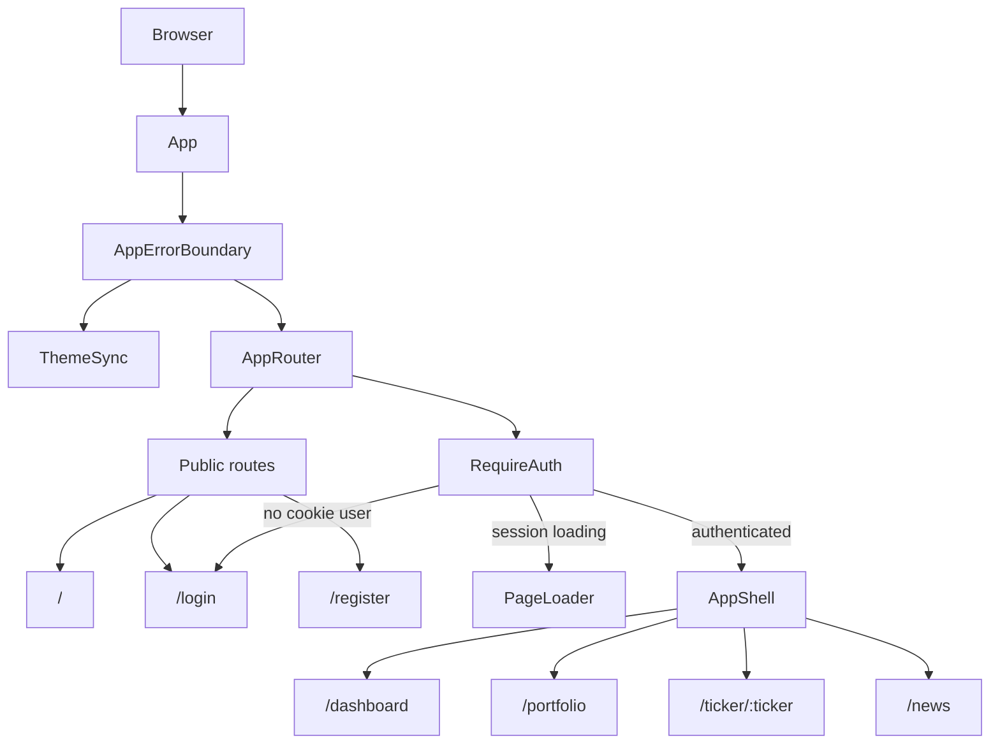
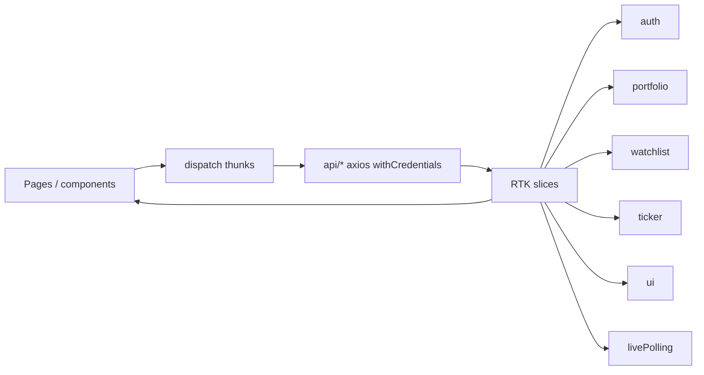
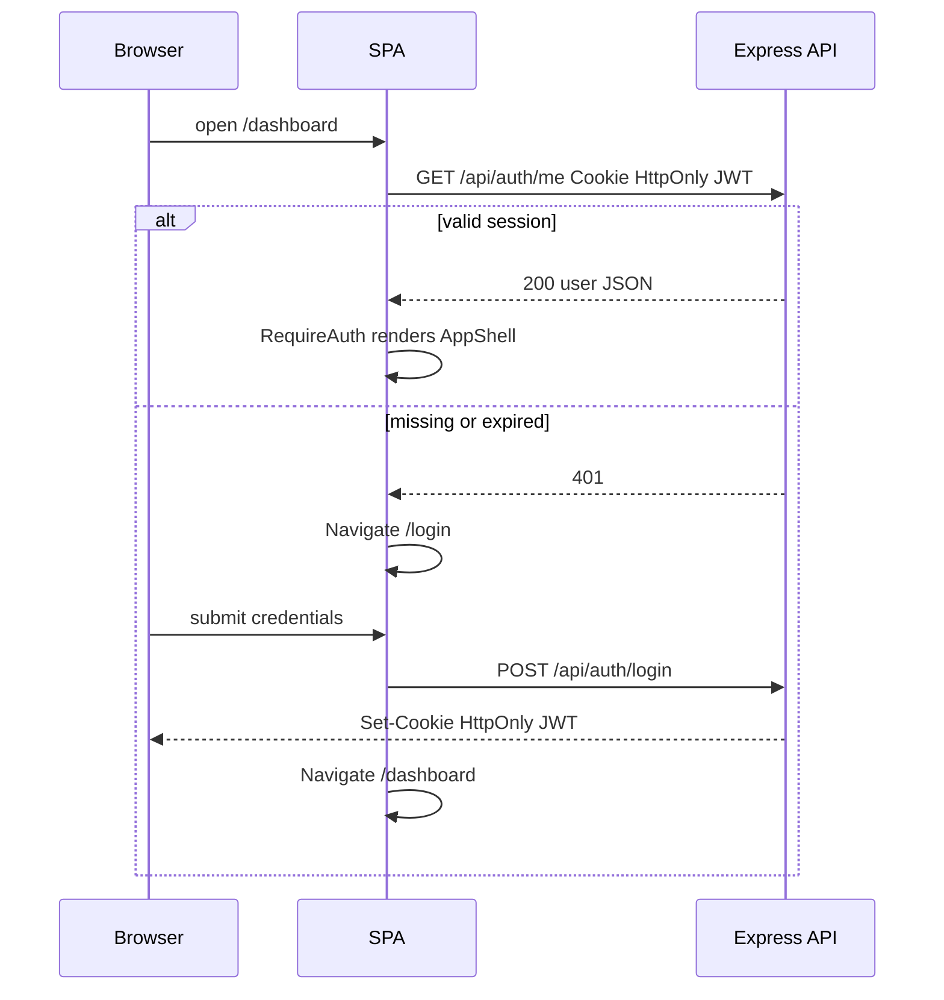

# Frontend Architecture

_Stack: React 19 + Vite + TypeScript + SCSS Modules_

---

## Folder structure

```
frontend/src/
├── app/                    # App root (providers, global setup)
│   └── App.tsx
├── router/                 # Route definitions
│   └── AppRouter.tsx
├── pages/                  # One folder per route/page
│   ├── LandingPage/
│   │   ├── LandingPage.tsx
│   │   └── LandingPage.module.scss
│   ├── AuthPage/
│   ├── PricingPage/
│   ├── SecurityPage/
│   └── DashboardPage/      # (planned)
├── components/             # Reusable UI pieces
│   ├── ui/                 # Primitive building blocks
│   │   ├── Button/
│   │   │   ├── Button.tsx
│   │   │   └── Button.module.scss
│   │   ├── Input/
│   │   │   ├── Input.tsx
│   │   │   └── Input.module.scss
│   │   └── index.ts        # Re-export all ui components
│   └── layout/             # Structural components
│       ├── Navbar/
│       │   ├── Navbar.tsx
│       │   └── Navbar.module.scss
│       ├── Footer/
│       │   ├── Footer.tsx
│       │   └── Footer.module.scss
│       └── index.ts
├── features/               # Feature slices (Redux + business logic)
│   ├── auth/
│   ├── dashboard/
│   ├── rebalancing/
│   ├── screener/
│   └── watchlist/
├── store/                  # Redux store setup
│   ├── index.ts
│   └── stockSlice.ts
├── api/                    # API call functions (axios clients)
│   └── stockApi.ts
├── hooks/                  # Custom React hooks
│   ├── useAppDispatch.ts
│   ├── useAppSelector.ts
│   └── useStockWebSocket.ts
├── types/                  # TypeScript interfaces and types
│   ├── stock.types.ts
│   └── ws.types.ts
├── utils/                  # Pure helper functions
├── styles/                 # Global SCSS tokens
│   ├── _variables.scss     # Colors, spacing, typography, breakpoints
│   ├── _mixins.scss        # Reusable SCSS mixins (e.g. @include mobile)
│   ├── _reset.scss
│   └── index.scss
└── constants.ts            # All FE constants (no magic values)
```

---

## Layer rules

### pages/
- One folder per route. Contains the page component + its own SCSS module.
- Pages **only compose** — they import components, hooks, and feature logic.
- Pages do NOT contain raw HTML primitives that other pages also use. Extract to `components/`.
- No business logic inside pages — delegate to feature slices or services.

### components/ui/
- **Stateless presentational primitives**: Button, Input, Select, Skeleton, AsyncStatePanel, etc.
- Accept only props — no `useNavigate`, no Redux, no API calls.
- Every primitive has its own folder with `Component.tsx` + `Component.module.scss`.
- Export everything via `components/ui/index.ts`.

```tsx
// Good
<Button variant="primary" size="lg" loading={isLoading} onClick={handleSubmit}>
  Sign In
</Button>

// Bad — raw HTML in page
<button className={styles.submitBtn} disabled={isLoading}>Sign In</button>
```

### components/layout/
- **Structural shell components**: Navbar, Footer, Sidebar, PageShell.
- May use `useNavigate` and `useLocation` — they own navigation.
- One instance per page, never nested inside feature components.

### features/
- Each feature folder owns its **Redux slice + async thunks + business logic**.
- Sub-structure inside a feature:
  ```
  features/dashboard/
  ├── dashboardSlice.ts       # Redux state
  ├── dashboardService.ts     # Business logic (pure functions)
  ├── DashboardPage.tsx       # (or live in pages/ and import from here)
  └── __tests__/
  ```
- Features do NOT import from each other. Shared state lives in `store/`.

### api/
- Raw axios functions that call the backend REST API.
- Return typed responses. No business logic.
- Called only from Redux thunks (`createAsyncThunk`) or hooks — never directly from components.

### hooks/
- Custom hooks encapsulate stateful logic that is reused across components.
- Naming: `useXxx`. Each hook has a single responsibility.

### constants.ts
- All magic values go here. No inline numbers or strings in components.
- Examples: `TICKER_CACHE_TTL_MS`, `ROUTES`, `WS_RECONNECT_DELAY_MS`.

---

## Styling rules

- **SCSS Modules only** — no Tailwind, no inline styles (except dynamic values).
- Global design tokens in `styles/_variables.scss`: colors, spacing, typography, z-index, transitions, border-radius.
- Shared mixins in `styles/_mixins.scss` (e.g. `@include mobile`).
- Every component imports its own module: `import styles from './Button.module.scss'`.
- `letter-spacing: -0.02em` on large headings (≥ 1.5rem).
- Glow effects live on `box-shadow`, not as separate DOM elements.

---

## State management

- **Redux Toolkit** for global/shared state (selected ticker, auth, portfolio).
- **Local `useState`** for UI-only state (modal open, tab active, form values).
- **No `useEffect` for derived state** — compute inline or with `useMemo`.

---

## Security rules

- JWT tokens live **only in HttpOnly cookies** — never `localStorage`.
- `withCredentials: true` on all axios clients that need auth.
- No personal data in state or logs.

---

## Component file template

```tsx
import styles from './MyComponent.module.scss';

interface MyComponentProps {
  label: string;
  onClick: () => void;
}

export function MyComponent({ label, onClick }: MyComponentProps) {
  return (
    <button className={styles.button} onClick={onClick}>
      {label}
    </button>
  );
}
```

- Named exports only (no `export default`).
- Props interface defined above the component.
- Full names for functions and variables — no `x`, `tmp`, `cb`.

---

## Architecture diagrams (diploma draft)

Thesis copy lives in `Docs/diploma/thesis/docs/02-technical/criteria/frontend.md`. Polish wording there before the zip.

### Modules, routes, shell



### Redux + HTTP



### Cookie auth user flow



JWT is never written to `localStorage`. Axios clients set `withCredentials: true`.

## Client API examples

Envelope matches the backend: `{ success, data }` or `{ success: false, error }`. Full paths are in `backend/openapi.yaml`.

**Login** — sets HttpOnly cookie, body is not a bearer token:

```http
POST /api/auth/login
Content-Type: application/json

{ "email": "investor@example.com", "password": "********" }
```

```json
{
  "success": true,
  "data": {
    "id": "…",
    "email": "investor@example.com",
    "emailVerified": true,
    "hasPassword": true,
    "hasGoogle": false
  }
}
```

Response also includes `Set-Cookie` (HttpOnly, not readable from JS).

**Session restore** on protected routes only (`RequireAuth` → `fetchCurrentUserThunk`). Public pages (landing, login, register) do not probe `/me`.

```http
GET /api/auth/me
Cookie: <HttpOnly JWT>
```

401 → `RequireAuth` sends the user to `/login`.

