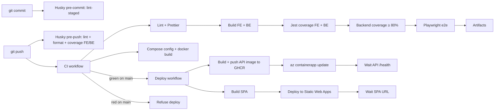

# Criterion: CI/CD

## Architecture Decision Record

### Status

**Status:** Accepted (CI + CD both live on GitHub Actions)

**Date:** 2026-08-18 (CI) → 2026-09-04 (CD auto-deploy on push)

### Context

Lint, build, and tests run on push and on pull requests. Husky runs the same checks on the developer machine before a push.

### Decision

GitHub Actions workflow `.github/workflows/ci.yml`:

- **backend:** lint, Prettier check, `tsc`, Jest with **80% coverage gate** (statements, lines, functions) and a 60% branch gate, upload `coverage/` (HTML + lcov).
- **backend-db:** PostgreSQL 16 service container; `npm run test:db` applies all migrations, runs the repository and API contract suites, uploads `coverage/db-integration/`, then runs `npm run load:test` (fails on any non-2xx response or p99 above 500 ms) and uploads `coverage/load-test/`.
- **frontend:** lint, Prettier check, production build, Jest coverage report.
- **audit:** `npm audit --audit-level=critical` per package; JSON report uploaded.
- **docker:** `docker compose config` plus `docker build` for API and web (no registry push).
- **e2e:** Playwright against a real Postgres service.

Triggers: `push` to `main` / `master` / `develop`, and every `pull_request`. npm cache via `package-lock.json`. Jobs fail on lint/build/test errors.

A separate workflow, `.github/workflows/asset-class-sentinel.yml`, runs the live Yahoo asset-class check on a nightly schedule (and `workflow_dispatch`). It is not part of the CI gate and does not trigger deploy.

Local push: Husky `pre-push` runs lint, format check, and `test:coverage` for **both** `backend/` and `frontend/` so a red backend coverage number never reaches GitHub. `pre-commit` is lint-staged only (fast).

CD is a separate workflow, `.github/workflows/deploy.yml`:

- Trigger: **`workflow_run` after CI completes on `main`**. If CI is red, a refuse job fails the deploy workflow and no Azure rollout happens. `workflow_dispatch` remains for an emergency redeploy without a new CI run.
- **deploy-backend:** builds + pushes the API image to GHCR (tag = the CI commit SHA), `az containerapp update`, then waits until `https://api.kreptonanalytics.com/health` is 200.
- **deploy-frontend:** builds the SPA (with the production `VITE_API_URL`), deploys to Azure Static Web Apps, then waits until the public site responds.
- Azure auth: a service-principal JSON in the `AZURE_CREDENTIALS` GitHub Secret (`az ad sp create-for-rbac --sdk-auth`, scoped to the resource group).

### Alternatives Considered

| Alternative                       | Why not                                                                                        |
| --------------------------------- | ---------------------------------------------------------------------------------------------- |
| Only Husky                        | Checks also run in GitHub Actions                                                              |
| Manual FTP of `dist`              | GitHub Actions builds and deploys                                                              |
| Full Kubernetes CD                | The API runs as an Azure Container App                                                         |
| Fail CI on every `npm audit` high | `xlsx` has no patched community build; we fail on **critical** and record high in the artifact |

## Pipeline

## Requirements Checklist

| #   | Requirement                        | Status | Evidence                                                                                                            |
| --- | ---------------------------------- | ------ | ------------------------------------------------------------------------------------------------------------------- |
| 1   | Pipeline diagram                   | ✅     | Mermaid above; [deployment.md](../cloud/deployment.md)                                                              |
| 2   | Tool described                     | ✅     | GitHub Actions                                                                                                      |
| 3   | CI ≥ 3 stages (lint, build, test)  | ✅     | `.github/workflows/ci.yml`                                                                                          |
| 4   | Some CD (even manual trigger)      | ✅     | `.github/workflows/deploy.yml` — after green CI on `main`, plus `workflow_dispatch`                                 |
| 5   | Auto on push/PR + dependency cache | ✅     | `on.push` / `on.pull_request`; `cache: npm`                                                                         |
| 6   | Artifacts                          | ✅     | `backend-coverage`, `backend-db-coverage`, `backend-load-test-report`, `frontend-coverage`, `npm-audit-*`, `*-dist` |
| 7   | Fail on error                      | ✅     | Non-zero Jest/lint/build/docker build fails the job                                                                 |
| 8   | Secrets store, not YAML            | ✅     | `AZURE_CREDENTIALS`, `AZURE_STATIC_WEB_APPS_API_TOKEN`, `VITE_GOOGLE_CLIENT_ID` in GitHub Secrets                   |
| 9   | Security scan (`npm audit`)        | ✅     | `audit` job + working note                                                                                          |

## References

- `.github/workflows/ci.yml`
- `.github/workflows/deploy.yml`
- `.husky/pre-push`
- `.husky/pre-commit`
- [deployment.md](../cloud/deployment.md)
- [automated-tests.md](../automated-tests/README.md)
