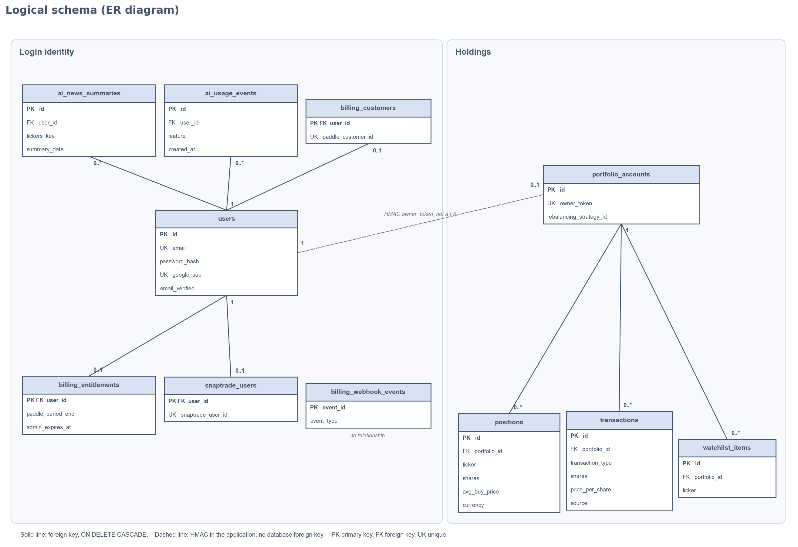

# Logical schema

This figure is the ER diagram: each box is a relation, the rows are its attributes, and the lines are the relationships with cardinality.

PostgreSQL OLTP. The schema is created by the migrations in `backend/src/migrations/` (`node-pg-migrate`). Nothing in production is created by hand.

Column lists, types, and keys: [data-dictionary.md](data-dictionary.md).

## ER diagram

The logical schema below is the ER diagram. It is drawn by `draw_schema.py`.



Composite unique keys `(portfolio_id, ticker)` on `positions` and `watchlist_items` are in the data dictionary. The diagram shows the foreign key that carries the relationship.

## Relationships

There is no foreign key from `portfolio_accounts` to `users`. The API stores `owner_token = HMAC-SHA256(user.id, PORTFOLIO_SECRET)`. A database dump cannot join holdings to an email without that secret.

```text
users.id  --HMAC in the API-->  portfolio_accounts.owner_token
```

| From | To | Kind | Rule |
|------|----|------|------|
| `users` | `ai_news_summaries` | one-to-many | FK `user_id`, ON DELETE CASCADE |
| `users` | `ai_usage_events` | one-to-many | FK `user_id`, ON DELETE CASCADE |
| `users` | `billing_customers` | one-to-one | PK/FK `user_id`, ON DELETE CASCADE |
| `users` | `billing_entitlements` | one-to-one | PK/FK `user_id`, ON DELETE CASCADE |
| `users` | `snaptrade_users` | one-to-one | PK/FK `user_id`, ON DELETE CASCADE |
| `portfolio_accounts` | `positions` | one-to-many | FK `portfolio_id`, ON DELETE CASCADE |
| `portfolio_accounts` | `transactions` | one-to-many | FK `portfolio_id`, ON DELETE CASCADE |
| `portfolio_accounts` | `watchlist_items` | one-to-many | FK `portfolio_id`, ON DELETE CASCADE |
| `billing_webhook_events` | — | standalone | Idempotency key for Paddle events. No user FK |

`positions` is the current aggregated lot. `transactions` is the buy/sell history. They are not substitutes for each other.

Market quotes are not a table. Prices come from Yahoo Finance and a short in-process cache.

## Normal form

| Table | Form | Why it stays this way |
|-------|------|------------------------|
| `users` | 3NF | One row per login identity |
| `portfolio_accounts` | 3NF | The HMAC token is not an email and not a user UUID |
| `positions` | 3NF | The lot depends on `(portfolio, ticker)` |
| `transactions` | 3NF | Each trade is its own event. Ticker and company name are the snapshot at trade time |
| `watchlist_items` | 3NF | Same shape as a position, without quantities |
| `ai_*` | 3NF plus a JSONB document | The daily summary is a cache, not a holdings warehouse |
| `billing_*`, `snaptrade_users` | 3NF | One row per user, or one row per webhook event id |

## What this schema does not add

Migrations, the indexes in the data dictionary, and HMAC anonymization are the database maximum this project claims. Azure point-in-time restore is a property of the managed PostgreSQL server. It is not a second database. There is no Timescale, ClickHouse, trigger layer, or view layer.
