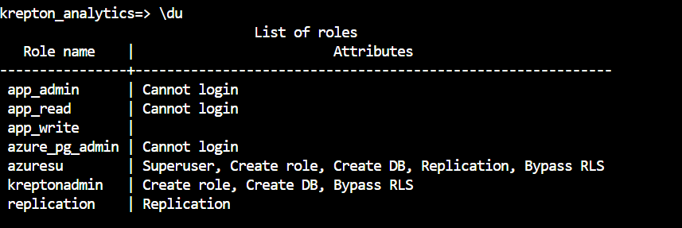

# Database roles

One API process, one runtime connection. Three PostgreSQL roles exist so the application is not a superuser and so an operator can show `\du`.

Created NOLOGIN by migration `1751370013000_add-app-database-roles.js`. The operator attaches LOGIN and a password outside Git. Passwords are not stored in this repository.

| Role | Login in Git | Who uses it |
|------|----------------|-------------|
| `app_read` | NOLOGIN | Not used by the API. Reserved for a report session |
| `app_write` | NOLOGIN | Staging and production API, after the operator adds LOGIN |
| `app_admin` | NOLOGIN | Operator role. `npm run migrate:up` runs as the database owner |

Local development may keep `DATABASE_URL` as the database owner. The roles are still created. On Azure PostgreSQL Flexible Server the API connects as `app_write`. Migrations run as the server admin through `DATABASE_MIGRATE_URL` (same host and database, admin user). `DATABASE_URL` stays `app_write`.

