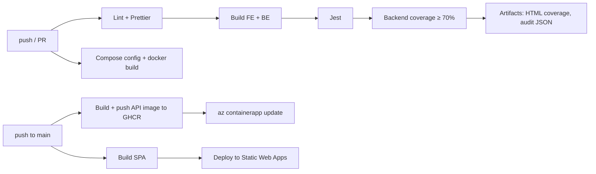

# Criterion: CI/CD

## Architecture Decision Record

### Status

**Status:** Accepted (CI + CD both live on GitHub Actions)

**Date:** 2026-08-18 (CI) → 2026-09-04 (CD auto-deploy on push)

### Context

Experts want automatic lint, build, and tests on push/PR, with at least a simple CD path. Husky is local-only and does not count as CI.

### Decision

GitHub Actions workflow `.github/workflows/ci.yml`:

- **backend:** lint, Prettier check, `tsc`, Jest with **70% coverage gate**, upload `coverage/` (HTML + lcov).
- **frontend:** lint, Prettier check, production build, Jest (no 70% gate yet).
- **audit:** `npm audit --audit-level=critical` per package; JSON report uploaded.
- **docker:** `docker compose config` plus `docker build` for API and web (no registry push).

Triggers: `push` to `main` / `master` / `develop`, and every `pull_request`. npm cache via `package-lock.json`. Jobs fail on lint/build/test errors.

Local push: Husky `pre-push` also runs lint, format check, and `backend` `test:coverage` so a red coverage number never reaches GitHub.

CD is a separate workflow, `.github/workflows/deploy.yml`:

- **deploy-backend:** builds + pushes the API image to GHCR, then `az containerapp update` rolls it out to Azure Container Apps.
- **deploy-frontend:** builds the SPA (with the production `VITE_API_URL`), then deploys the static build to Azure Static Web Apps.
- Triggers: automatically on every `push` to `main` (both jobs run in full), and via `workflow_dispatch` with per-side checkboxes for a manual redeploy with no new commit (e.g. after a Portal-side fix) or a one-side-only rollout.
- Azure auth: a service-principal JSON in the `AZURE_CREDENTIALS` GitHub Secret (`az ad sp create-for-rbac --sdk-auth`, scoped to the resource group).

This closes the CI/CD **min** hole that used to require phase D4.

### Alternatives Considered

| Alternative | Why not |
|-------------|---------|
| Only Husky | Not CI; not visible to experts |
| Manual FTP of `dist` | Forbidden by the rubric |
| Full Kubernetes CD | Other criteria; YAGNI |
| Fail CI on every `npm audit` high | `xlsx` has no patched community build; we fail on **critical** and record high in the artifact |

### Consequences

**Positive:** Same CI pipeline serves Backend coverage + Auto tests logs; CD is a separate workflow so a red CI does not block iterating on the deploy YAML itself, and pushing to `main` now ships to production with zero manual steps.  
**Negative:** `pre-push` is slower (~20 s Jest). Frontend coverage is not gated. CD does not (yet) hard-block on CI's own green status — see Known Limitations.

## Pipeline

## Requirements Checklist

| # | Requirement | Status | Evidence |
|---|-------------|--------|----------|
| 1 | Pipeline diagram | ✅ | Mermaid above; [deployment.md](../deployment.md) |
| 2 | Tool described | ✅ | GitHub Actions |
| 3 | CI ≥ 3 stages (lint, build, test) | ✅ | `.github/workflows/ci.yml` |
| 4 | Some CD (even manual trigger) | ✅ | `.github/workflows/deploy.yml` — auto on push to `main`, plus `workflow_dispatch` |
| 5 | Auto on push/PR + dependency cache | ✅ | `on.push` / `on.pull_request`; `cache: npm` |
| 6 | Artifacts | ✅ | `backend-coverage`, `npm-audit-*`, `*-dist` |
| 7 | Fail on error | ✅ | Non-zero Jest/lint/build/docker build fails the job |
| 8 | Secrets store, not YAML | ✅ | `AZURE_CREDENTIALS`, `AZURE_STATIC_WEB_APPS_API_TOKEN`, `VITE_GOOGLE_CLIENT_ID` in GitHub Secrets |
| 9 | Security scan (`npm audit`) | ✅ | `audit` job + working note |

## Known Limitations

| Limitation | Impact | Plan |
|------------|--------|------|
| CD does not gate on the separate CI workflow's result | A push with failing lint/tests still deploys if the deploy job itself succeeds | Backend **max** item: make `deploy.yml` depend on `ci.yml` passing (`workflow_run` / required status check) |
| No blue/green or rollback step | A bad image replaces the previous revision directly | Container Apps keeps prior revisions; manual rollback via Portal is documented, automated rollback is CI/CD **max**, not claimed |

## References

- `.github/workflows/ci.yml`
- `.github/workflows/deploy.yml`
- `.husky/pre-push`
- [deployment.md](../deployment.md)
- [automated-tests.md](automated-tests.md)
