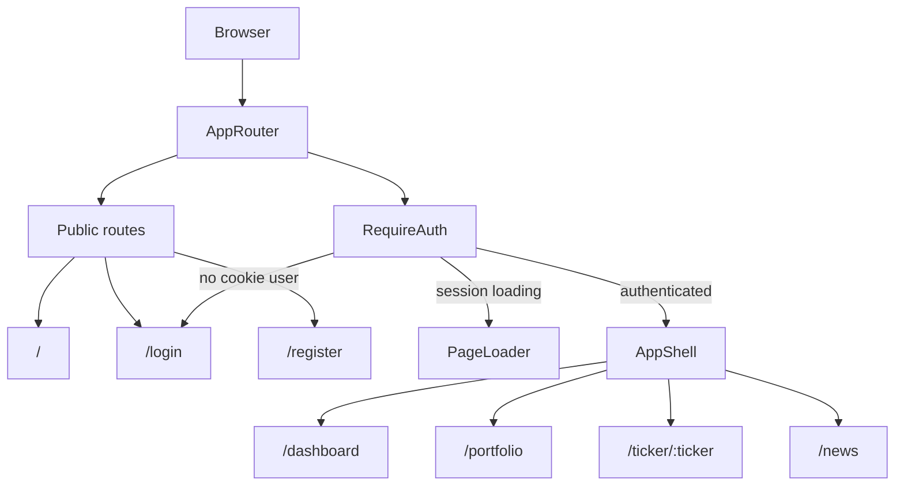
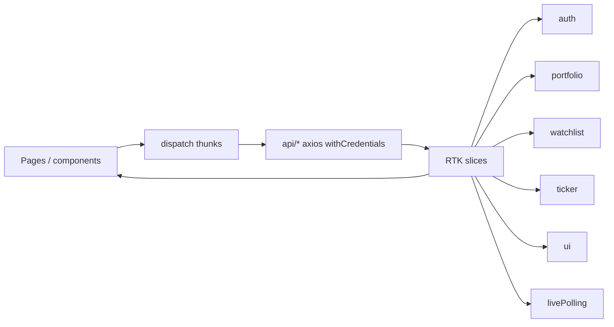
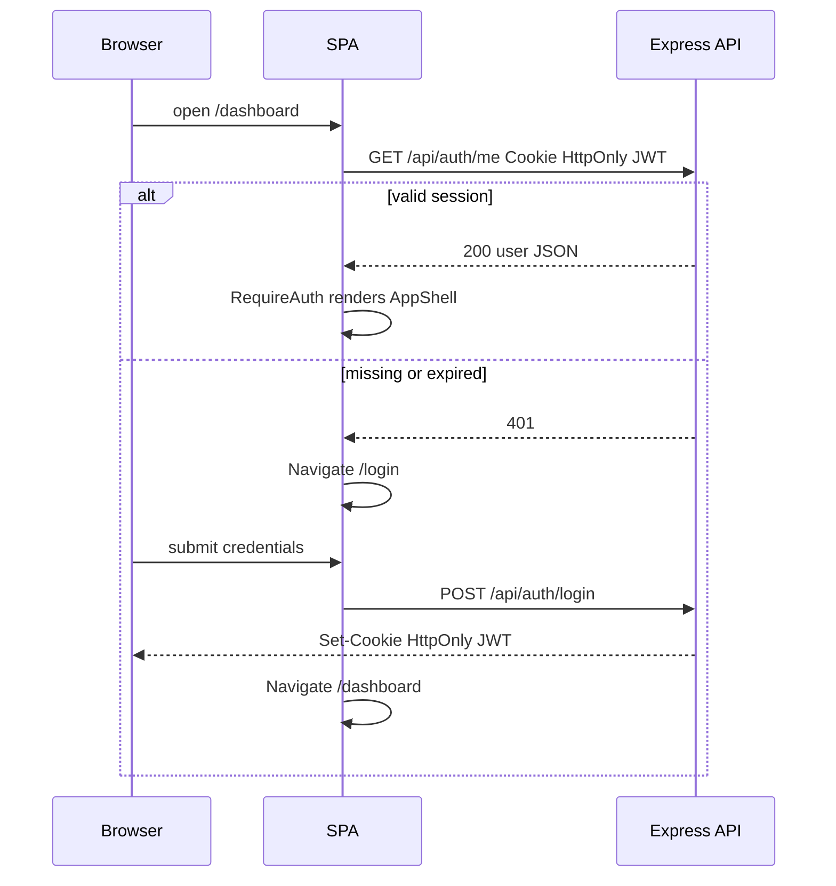

# Criterion: Frontend

## Architecture Decision Record

### Status

**Status:** Accepted (React SPA)

**Date:** 2026-08-18

### Context

Frontend min requires a SPA with routing, global state, forms, lists/filters, responsive layout, error handling, and tests. The UI must talk to the real API with cookie credentials.

### Decision

React 19 + Vite + TypeScript + React Router + Redux Toolkit + SCSS modules. Pages compose; `api/` is the only HTTP layer; tokens never touch `localStorage`.

### Alternatives Considered

| Alternative | Why not |
|-------------|---------|
| Next.js | SSR not needed; cookie-to-API is simpler as a SPA |
| LocalStorage JWT | Forbidden by project security rules |
| CSS-in-JS / Tailwind | SCSS modules + tokens already match the design system |
| No global store | Auth, portfolio, quotes are cross-page |

### Consequences

**Positive:** Matches Frontend min architecture list.  
**Negative:** Playwright e2e still waits for a public staging URL.  
**Neutral:** Adaptive UI as a **separate criterion** is not declared.

## Implementation Details

### Project Structure

```
frontend/src/
├── app/           # providers + AppErrorBoundary
├── router/        # ≥ 4 routes (landing, auth, dashboard, ticker, news, …)
├── pages/
├── components/    # ui + layout
├── features/      # slices
├── store/
├── api/           # axios, withCredentials
├── hooks/
├── types/
├── styles/        # tokens, mixins
└── constants.ts
```

### Key Implementation Decisions

| Decision | Rationale |
|----------|-----------|
| RTK + local useState | Global vs widget state split |
| SCSS modules | No inline-style soup |
| `withCredentials: true` | Cookie session |
| Central axios + Error Boundary | HTTP errors and render crashes both have UI |

### Routes and navigation



### Redux slices



### Cookie session



JWT never enters `localStorage`. Axios uses `withCredentials: true`. Render crashes are caught by `AppErrorBoundary` (fallback + `console.error`), not a white screen.

## Requirements Checklist

| # | Requirement | Status | Evidence |
|---|-------------|--------|----------|
| 1 | SPA + modern framework | ✅ | React + Vite |
| 2 | Architecture diagram / stack justification | ✅ | This file + [tech-stack](../tech-stack.md) |
| 3 | 3–4+ routes | ✅ | App router |
| 4 | Global state | ✅ | Redux Toolkit |
| 5 | Typed API client | ✅ | TypeScript + `api/` |
| 6 | Forms + validation, lists, filter/search | ✅ | Auth, import, screener/search |
| 7 | Responsive desktop + mobile | ⚠️ | Tokens/mixins; tablet evidence screenshots TBD |
| 8 | ESLint + Prettier | ✅ | |
| 9 | Global errors + user-visible messages | ✅ | Interceptor, ErrorBanner, AppErrorBoundary |
| 10 | Unit tests ≥ 3 components + 1–2 e2e | ⚠️ | 3 RTL suites; Playwright still D-later |
| 11 | No tokens in code | ✅ | |

## Known Limitations

| Limitation | Impact | Plan |
|------------|--------|------|
| No Playwright smoke | Auto tests max / extra FE min | Staging URL in D4 |
| Tablet screenshots | Responsive evidence | Capture before pre-defense |

## References

- Engineering copy: `Docs/ARCHITECTURE_FRONTEND.md` (not in the final zip)
- `frontend/src/router`, `store`, `api`, `app/AppErrorBoundary.tsx`
