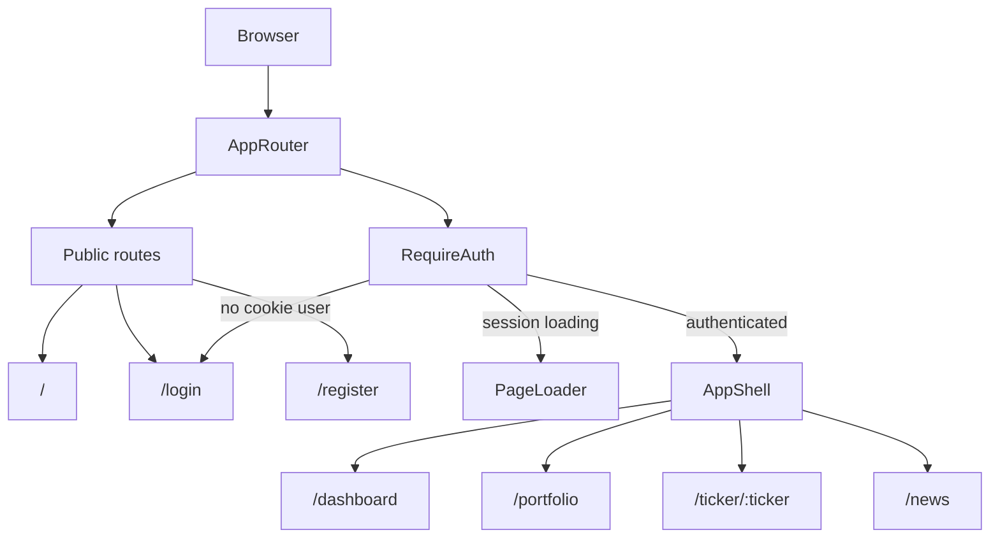
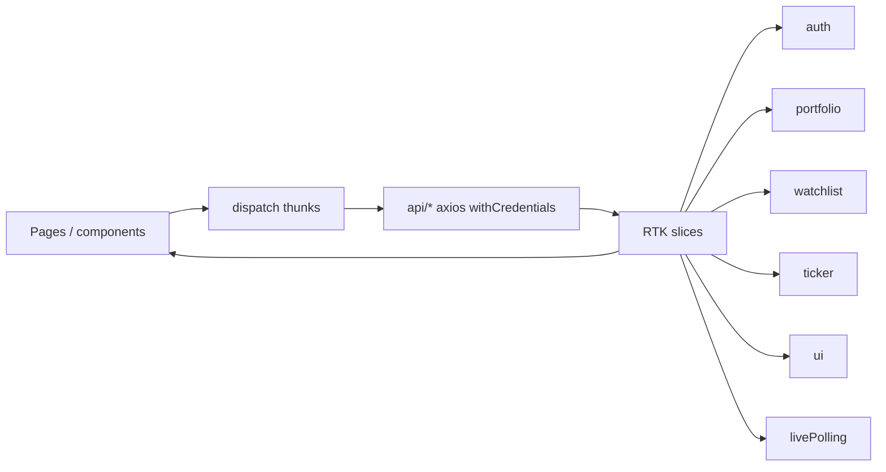
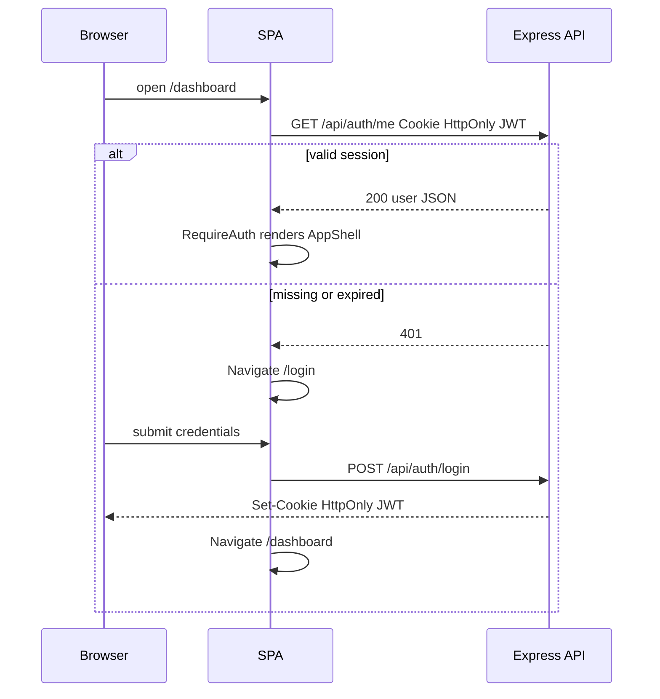
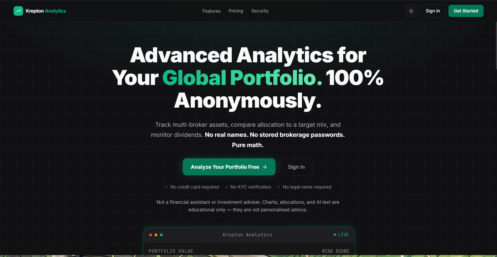
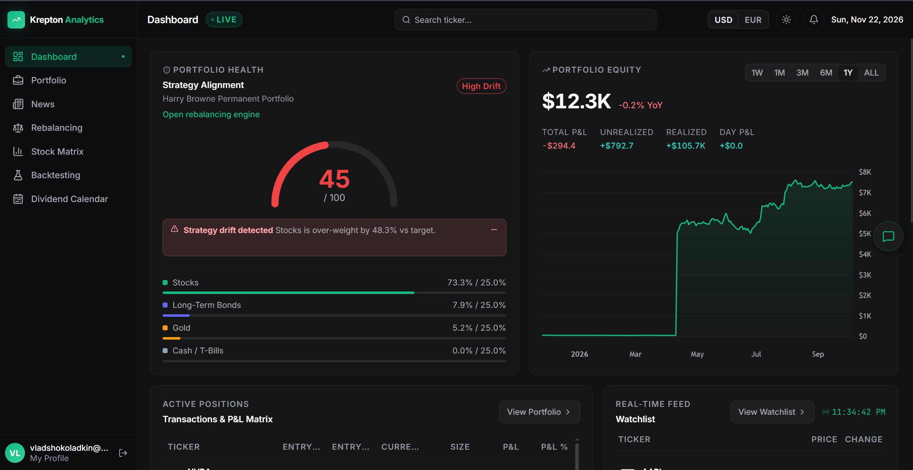
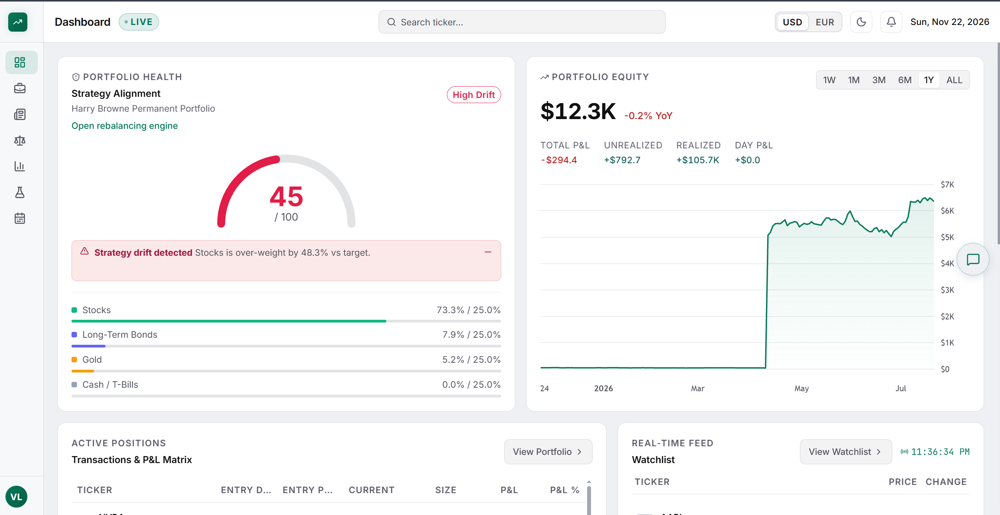
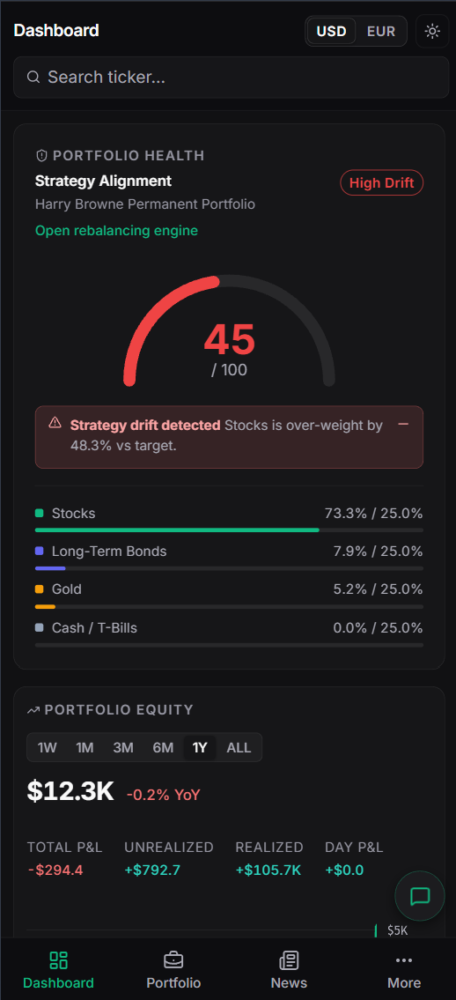
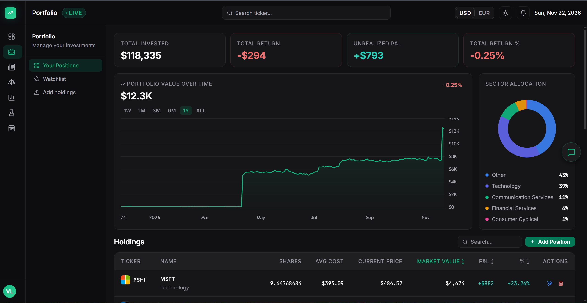
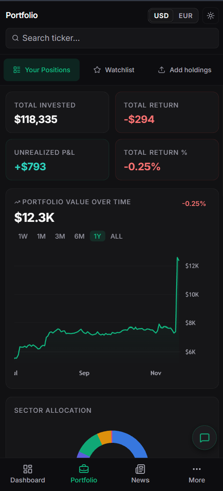
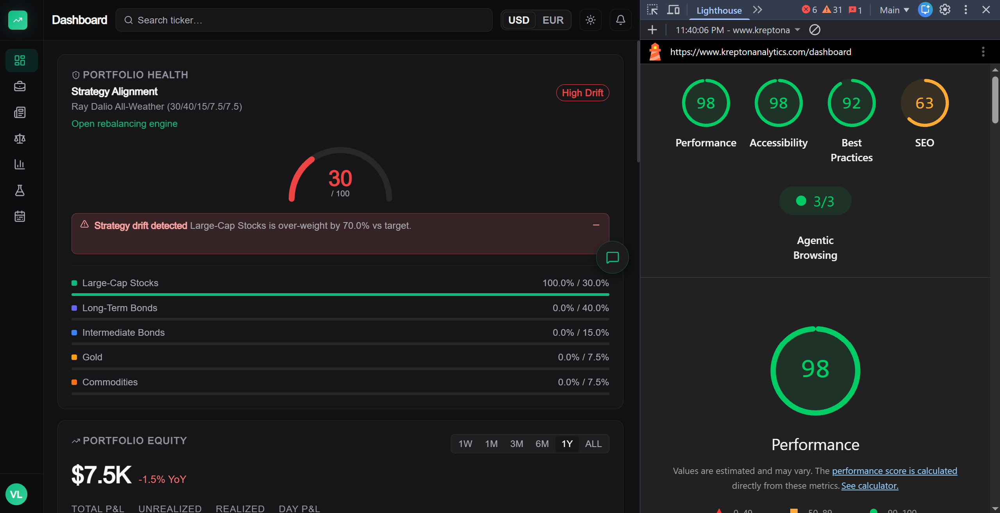

# Criterion: Frontend

## Architecture Decision Record

### Context

Frontend min requires a SPA with routing, global state, forms, lists/filters, responsive layout, error handling, and tests. The UI must talk to the real API with cookie credentials.

### Decision

React 19 + Vite + TypeScript + React Router + Redux Toolkit + SCSS modules. Pages compose; `api/` is the only HTTP layer; tokens never touch `localStorage`.

### Alternatives Considered

| Alternative | Why not |
|-------------|---------|
| Next.js | SSR not needed; cookie-to-API is simpler as a SPA |
| LocalStorage JWT | Forbidden by project security rules |
| CSS-in-JS / Tailwind | SCSS modules + tokens already match the design system |
| No global store | Auth, portfolio, quotes are cross-page |

## How to open it

The live app is [https://www.kreptonanalytics.com](https://www.kreptonanalytics.com). The API is [https://api.kreptonanalytics.com](https://api.kreptonanalytics.com).

Local frontend, after the API is up (see the repository [README](../../../../../README.md)):

```bash
cd frontend
cp .env.example .env
npm install
npm run dev
```

App: http://localhost:5173. The dev server proxies nothing by itself: `VITE_API_URL` in `frontend/.env` must point at the API (local default `http://localhost:3001`).

```bash
cd frontend
npm test
npm run lint
npm run test:e2e
```

`npm test` is Jest and React Testing Library. `npm run test:e2e` is Playwright (`frontend/e2e/login.spec.ts`) and expects a migrated, seeded API. Details are in `frontend/e2e/README.md`.

## Where to look

| Path | Contents |
|------|------------------------|
| `frontend/src/main.tsx` | Store provider and the 401 handler |
| `frontend/src/app/App.tsx` | `AppErrorBoundary` around the router |
| `frontend/src/router/AppRouter.tsx` | Lazy routes and `RequireAuth` |
| `frontend/src/router/RequireAuth.tsx` | Session check via `GET /api/auth/me` |
| `frontend/src/store/index.ts` | The one Redux store |
| `frontend/src/features/` | Slices: `auth`, `portfolio`, `watchlist`, `ticker`, `ui`, `livePolling` |
| `frontend/src/features/portfolio/portfolioSelectors.ts` | `selectPortfolioStats` (`createSelector`) |
| `frontend/src/api/apiClient.ts` | Axios instance, `withCredentials: true` |
| `frontend/src/pages/` | One folder per screen |
| `frontend/src/components/ui/` | Custom kit: `Button`, `Input`, `Select`, `Skeleton` |
| `frontend/src/styles/` | Tokens, mixins, light/dark theme |
| `frontend/src/constants.ts` | Routes, copy, and numeric limits |
| `frontend/e2e/login.spec.ts` | End-to-end login |

Shared portfolio and auth data goes through thunks. Screen-local actions (password change, import, backtest, chat, billing) call `api/` from the page that owns them.

## Implementation Details

### Project Structure

```
frontend/src/
├── app/           # providers + AppErrorBoundary
├── router/        # lazy routes, RequireAuth
├── pages/         # one folder per screen
├── components/    # ui kit + layout
├── features/      # Redux slices and selectors
├── store/
├── api/           # axios, withCredentials
├── hooks/
├── types/
├── styles/        # tokens, mixins
└── constants.ts
```

Quotes are not loaded in the browser from Yahoo. The SPA asks the Express API. Live quotes on the dashboard and the watchlist are refreshed by polling (`useHoldingsPolling`, `useWatchlistPolling`).

### Key Implementation Decisions

| Decision | Rationale |
|----------|-----------|
| RTK + local useState | Shared data in the store; dialog and form state stays on the screen |
| `createSelector` for portfolio stats | Dashboard reads a stable stats object |
| `Skeleton` + `AsyncStatePanel` | Page and list fetches use layout placeholders; button and search mutations keep a spinner |
| `ContentSkeleton` owns `role="status"` | One announcement per pending fetch |
| `LOADING_MESSAGES` in `constants.ts` | The same string is the accessible name and the visible label |
| SCSS modules | Component styles stay next to the component |
| `withCredentials: true` | Cookie session |
| Central axios + error boundary | HTTP errors and render crashes both have UI |

### Routes and navigation

Public: `/`, `/pricing`, `/security`, `/login`, `/register`, email verification, and password reset.

After `RequireAuth`: `/dashboard`, `/portfolio`, `/rebalancing`, `/screener`, `/backtesting`, `/dividends`, `/news`, `/ticker/:ticker`, `/profile`, `/subscription`.



### Redux slices



### Cookie session



JWT never enters `localStorage`. Axios uses `withCredentials: true`. Render crashes are caught by `AppErrorBoundary` (fallback + `console.error`), not a white screen.

## Screenshots

Captured on the production site, 2026-11-22. Desktop frames are a wide window. Mobile frames are a phone-width layout. The gauge on the dashboard is the strategy alignment score, not a Lighthouse score.

### Landing




### Dashboard







### Portfolio





### Lighthouse

Chrome Lighthouse on [https://www.kreptonanalytics.com/dashboard](https://www.kreptonanalytics.com/dashboard), 2026-11-22. Performance 98, Accessibility 98, Best Practices 92.



## Requirements Checklist

| # | Requirement | Status | Evidence |
|---|-------------|--------|----------|
| 1 | SPA + modern framework | ✅ | React 19 + Vite |
| 2 | Architecture diagram / stack justification | ✅ | This file + [tech-stack](../tech-stack.md) |
| 3 | 3–4+ routes | ✅ | `frontend/src/router/AppRouter.tsx` |
| 4 | Global state | ✅ | Redux Toolkit, `frontend/src/store/index.ts` |
| 5 | Typed API client | ✅ | TypeScript + `frontend/src/api/` |
| 6 | Forms + validation, lists, filter/search | ✅ | Auth, portfolio holdings, screener |
| 7 | Responsive desktop + mobile | ✅ | Landing, dashboard, and portfolio screenshots above |
| 8 | ESLint + Prettier | ✅ | `frontend` scripts `lint`, `format:check` |
| 9 | Global errors + user-visible messages | ✅ | Axios interceptor, `ErrorBanner`, `AppErrorBoundary` |
| 10 | Skeleton/loading on async fetches | ✅ | `Skeleton`, `AsyncStatePanel`; search and auth keep a button spinner |
| 11 | Unit tests ≥ 3 components + 1–2 e2e | ✅ | Jest + React Testing Library; Playwright `frontend/e2e/login.spec.ts` |
| 12 | No tokens in code | ✅ | HttpOnly cookie; `localStorage` holds theme and UI preferences only |
| 13 | Max: lazy routes + RTK + charts/theme | ✅ | Lazy routes, Redux Toolkit, charts, light/dark theme |
| 14 | Max: performance evidence | ✅ | Production dashboard Lighthouse: Performance 98 (2026-11-22) |
| 15 | Max: accessibility check | ✅ | Contrast, landmarks, labels, headings, keyboard pass. Lighthouse Accessibility 98 on the same report |

## References

- `frontend/src/router`, `frontend/src/store`, `frontend/src/api`, `frontend/src/app/AppErrorBoundary.tsx`
- Repository [README](../../../../../README.md) for the local API, database, and demo seed
