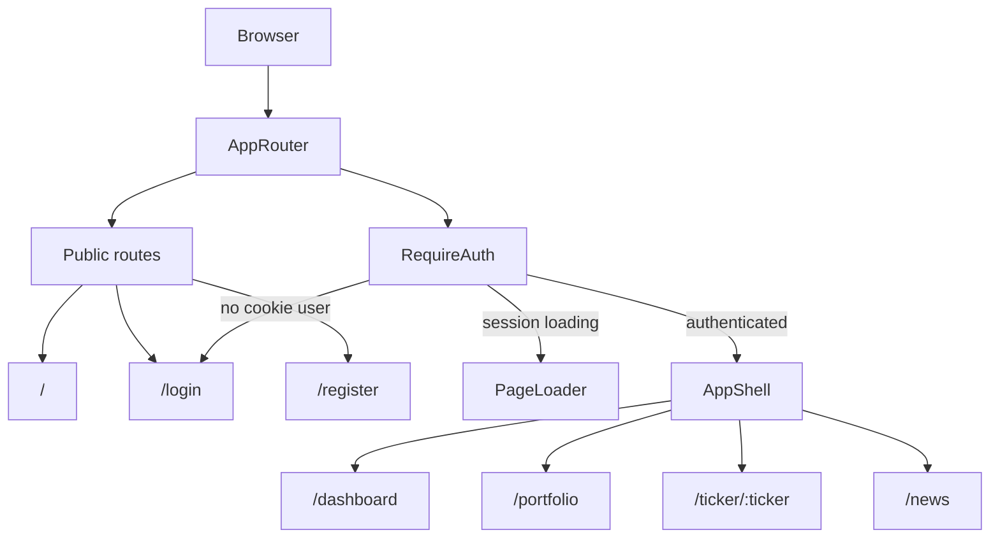
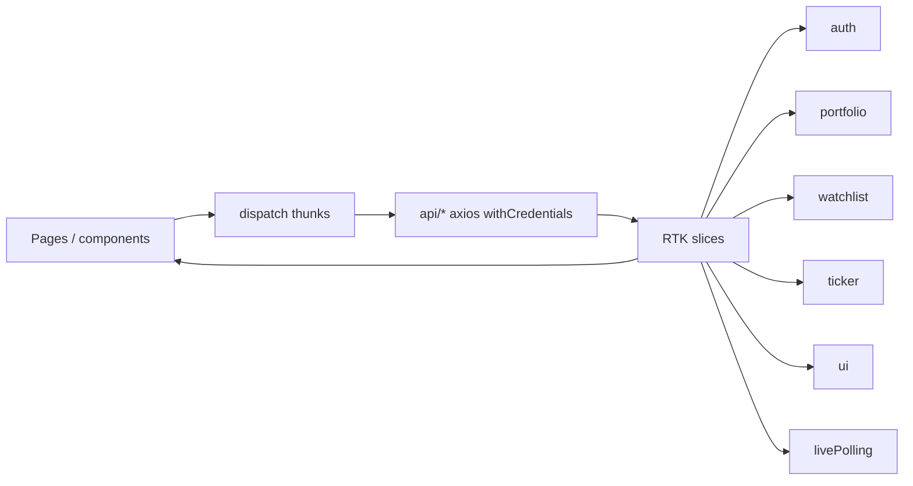
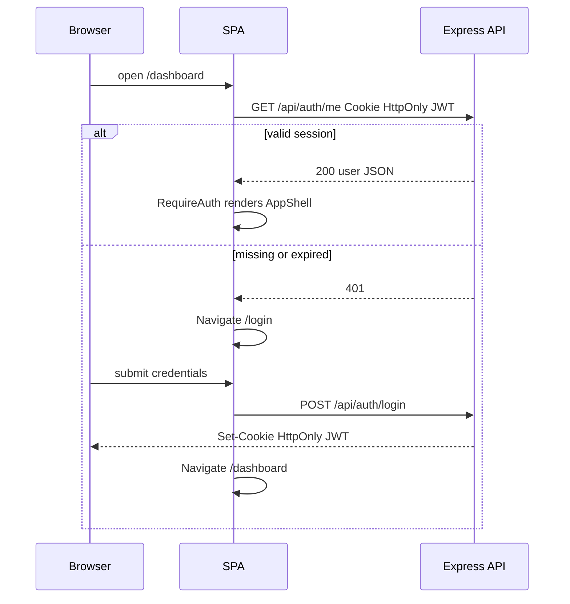

# Criterion: Frontend

## Architecture Decision Record

### Status

**Status:** Accepted (React SPA)

**Date:** 2026-08-18

### Context

Frontend min requires a SPA with routing, global state, forms, lists/filters, responsive layout, error handling, and tests. The UI must talk to the real API with cookie credentials.

### Decision

React 19 + Vite + TypeScript + React Router + Redux Toolkit + SCSS modules. Pages compose; `api/` is the only HTTP layer; tokens never touch `localStorage`.

### Alternatives Considered

| Alternative | Why not |
|-------------|---------|
| Next.js | SSR not needed; cookie-to-API is simpler as a SPA |
| LocalStorage JWT | Forbidden by project security rules |
| CSS-in-JS / Tailwind | SCSS modules + tokens already match the design system |
| No global store | Auth, portfolio, quotes are cross-page |

### Consequences

**Positive:** Matches Frontend min architecture list.  
**Negative:** Playwright e2e still waits for a public staging URL.  
**Neutral:** Adaptive UI / Refined UX as **separate criteria** are not declared. Frontend max target is 7–8 via lazy + RTK + charts. Lighthouse is a walkthrough (prod build, landing + dashboard), not a promise of Performance ≥ 90 on the chart-heavy dashboard. Accessibility is an evidence check (Lighthouse a11y + keyboard + axe), not a WCAG criterion.

## Implementation Details

### Project Structure

```
frontend/src/
├── app/           # providers + AppErrorBoundary
├── router/        # ≥ 4 routes (landing, auth, dashboard, ticker, news, …)
├── pages/
├── components/    # ui + layout
├── features/      # slices
├── store/
├── api/           # axios, withCredentials
├── hooks/
├── types/
├── styles/        # tokens, mixins
└── constants.ts
```

### Key Implementation Decisions

| Decision | Rationale |
|----------|-----------|
| RTK + local useState | Global vs widget state split |
| `Skeleton` + `AsyncStatePanel` | Page/list fetches use layout placeholders; button/search mutations keep a spinner |
| `ContentSkeleton` owns `role="status"` | One announcement per pending fetch, no duplicated wrappers at call sites |
| `LOADING_MESSAGES` in `constants.ts` | Same string serves the accessible name and the visible pending label |
| SCSS modules | No inline-style soup; skeleton geometry is CSS, counts are constants |
| `withCredentials: true` | Cookie session |
| Central axios + Error Boundary | HTTP errors and render crashes both have UI |

### Routes and navigation



### Redux slices



### Cookie session



JWT never enters `localStorage`. Axios uses `withCredentials: true`. Render crashes are caught by `AppErrorBoundary` (fallback + `console.error`), not a white screen.

## Requirements Checklist

| # | Requirement | Status | Evidence |
|---|-------------|--------|----------|
| 1 | SPA + modern framework | ✅ | React + Vite |
| 2 | Architecture diagram / stack justification | ✅ | This file + [tech-stack](../tech-stack.md) |
| 3 | 3–4+ routes | ✅ | App router |
| 4 | Global state | ✅ | Redux Toolkit |
| 5 | Typed API client | ✅ | TypeScript + `api/` |
| 6 | Forms + validation, lists, filter/search | ✅ | Auth, import, screener/search |
| 7 | Responsive desktop + mobile | ⚠️ | Tokens/mixins; screenshots still to capture for the thesis |
| 8 | ESLint + Prettier | ✅ | |
| 9 | Global errors + user-visible messages | ✅ | Interceptor, ErrorBanner, AppErrorBoundary |
| 10 | Skeleton/loading on async fetches | ✅ | `Skeleton`, `AsyncStatePanel` presets; search/auth keep button spinners |
| 11 | Unit tests ≥ 3 components + 1–2 e2e | ⚠️ | React Testing Library is in place; Playwright smoke is the product check |
| 12 | No tokens in code | ✅ | |
| 13 | Max: lazy routes + RTK + charts/theme | ✅ | Three directions already in code |
| 14 | Max: performance evidence | ⚠️ | Lighthouse walkthrough 2026-08-21 (`vite preview`); bundle visualizer TBD; dashboard Performance 90 not claimed |
| 15 | Max: accessibility check | ✅ | Contrast/landmarks/labels/headings; Lighthouse a11y on landing, auth, pricing, security, app screens (light/dark). Not Adaptive UI |
| 16 | Max skip | — | No FSD, Next, Figma-as-Frontend, Storybook, Sentry, toast lib, PWA |
| 17 | Later (not max) | — | i18n EN+RU after the eight criteria; defense stays EN UI |

## Known Limitations

| Limitation | Impact | Plan |
|------------|--------|------|
| No Playwright smoke | Frontend min e2e + Auto tests | Staging URL in D4 or local API |
| Tablet screenshots | Responsive evidence | Capture before pre-defense |
| Dashboard Lighthouse Performance 45 (dev, 2026-08-19) | Expert may ask for 90 | Walk through report on **prod build** (2026-08-21 preview); accept charts/polling; do not fake the score |
| Accessibility not a declared criterion | Still need evidence | Lighthouse a11y walkthrough 2026-08-21; remaining (keyboard/axe, HTTPS staging) in appendix / D4 |

## References

- `frontend/src/router`, `store`, `api`, `app/AppErrorBoundary.tsx`
