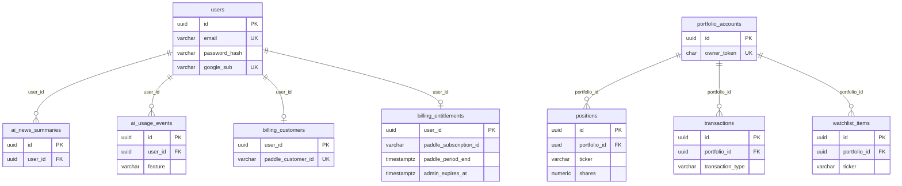

<!-- prev: ai-lab-latency.md | next: none -->

# Database Schema

| Attribute | Value |
|-----------|-------|
| **Database** | PostgreSQL |
| **DDL** | `backend/src/migrations/` (node-pg-migrate) |
| **ORM** | drizzle-orm for `users`, `watchlist_items`, `ai_news_summaries`, `ai_usage_events`; HMAC portfolio still SQL |
| **Roles** | `app_read` / `app_write` / `app_admin` — see working note `Docs/diploma/DATABASE_ROLES.md` |
| **Seed** | `cd backend && npm run seed:demo` (refused when `NODE_ENV=production`) |

## Entity relationship

There is **no** FK from `portfolio_accounts` to `users`. The API stores `owner_token = HMAC-SHA256(user.id, PORTFOLIO_SECRET)`. A dump of the database cannot join holdings to email without the secret.



Application link (not a database FK):

```
users.id  --HMAC in API-->  portfolio_accounts.owner_token
```

## Data dictionary

### users

Anonymous identity. No legal name, phone, or broker account number.

| Column | Type | Constraints |
|--------|------|-------------|
| id | uuid | PK, `gen_random_uuid()` |
| email | varchar(255) | UNIQUE NOT NULL |
| password_hash | varchar(255) | nullable (Google-only accounts); bcrypt when set |
| google_sub | varchar(255) | UNIQUE, nullable |
| email_verified | boolean | NOT NULL default false |
| email_verification_token_hash | varchar(64) | nullable, SHA-256 hex |
| email_verification_expires_at | timestamptz | nullable |
| password_reset_token_hash | varchar(64) | nullable |
| password_reset_expires_at | timestamptz | nullable |
| created_at | timestamptz | NOT NULL |

CHECK: `password_hash IS NOT NULL OR google_sub IS NOT NULL`. Index: `email`.

### portfolio_accounts

| Column | Type | Constraints |
|--------|------|-------------|
| id | uuid | PK |
| owner_token | char(64) | UNIQUE NOT NULL, CHECK hex HMAC |
| rebalancing_strategy_id | varchar(64) | NOT NULL, CHECK known strategy ids |
| rebalancing_custom_allocations | jsonb | nullable |
| rebalancing_custom_base_strategy_id | varchar(64) | nullable |
| created_at | timestamptz | NOT NULL |

Index: `owner_token` (lookup on every authenticated portfolio request).

### positions

Current aggregated lot per ticker.

| Column | Type | Constraints |
|--------|------|-------------|
| id | uuid | PK |
| portfolio_id | uuid | FK → portfolio_accounts ON DELETE CASCADE |
| ticker | varchar(10) | NOT NULL, CHECK format |
| company_name | varchar(255) | NOT NULL, CHECK not blank |
| shares | numeric(18,8) | NOT NULL, CHECK `> 0` and `<= 999999999` |
| avg_buy_price | numeric(18,8) | NOT NULL, CHECK `> 0` |
| currency | varchar(3) | NOT NULL default USD, CHECK `USD`/`EUR` |
| sector | varchar(100) | nullable |
| entry_date | date | nullable |
| created_at / updated_at | timestamptz | NOT NULL |

UNIQUE `(portfolio_id, ticker)`. Index: `portfolio_id`.

### transactions

Immutable buy/sell history (not a substitute for `positions`).

Same money/ticker CHECKs as positions. `transaction_type` CHECK `BUY`/`SELL`. Indexes: `portfolio_id`, `(portfolio_id, ticker)`.

### watchlist_items

FK `portfolio_id`; UNIQUE `(portfolio_id, ticker)`; ticker/name CHECKs as positions.

### ai_news_summaries

FK `user_id` → `users` ON DELETE CASCADE. UNIQUE `(user_id, tickers_key, summary_date)`. `tickers` jsonb CHECK array.

Quota/cache is tied to login identity (email), not to HMAC holdings.

### ai_usage_events

FK `user_id`. `feature` CHECK `news_summary` / `explain_alignment` / `import_schema` / `ticker_chat`. Index `(user_id, feature, created_at)`.

## Integrity

- **Constraints:** PK, FK CASCADE, UNIQUE, NOT NULL, and CHECKs in `1751370012000_add-data-integrity-checks.js`.
- **Transactions:** multi-step portfolio writes use `BEGIN`/`COMMIT`/`ROLLBACK` in `portfolioRepository.ts` (add/close position, import confirm).
- **Passwords:** bcrypt only. Tokens in the table are hashes, never the raw email-verify / reset secret.

## 3NF note

| Table | Form | Why we did not denormalize |
|-------|------|----------------------------|
| users | 3NF | One fact per login identity |
| portfolio_accounts | 3NF | HMAC token is not an email and not a user UUID |
| positions | 3NF | Aggregated state depends on `(portfolio, ticker)` |
| transactions | 3NF | Each trade is its own event; repeating ticker/company is the lot snapshot at trade time, not a second entity |
| watchlist_items | 3NF | Same as positions without quantities |
| ai_* | 3NF + JSONB blob | Daily summary payload is a cache document, not a holdings warehouse |

Quotes are **not** stored as a market-data table (by design). Live/cached Yahoo is the source of truth for prices.

## Indexes (why)

| Index | Why |
|-------|-----|
| `users.email` | Login lookup, UNIQUE |
| `portfolio_accounts.owner_token` | Every request maps JWT user → HMAC → portfolio UUID |
| `positions.portfolio_id` | Dashboard / holdings list |
| `transactions (portfolio_id, ticker)` | Chart markers and P&amp;L per lot |
| `watchlist_items.portfolio_id` | Watchlist panel |
| `ai_usage_events (user_id, feature, created_at)` | Daily quota count |

## Migrations

All versioned under `backend/src/migrations/`. Runtime user on staging should be `app_write`, not superuser.

## Seeding

```bash
cd backend
npm run seed:demo
```

Creates `demo@krepton.local` if missing (AAPL + MSFT lots, NVDA watchlist). Idempotent: skips when the email already exists. Refused when `NODE_ENV=production`.
