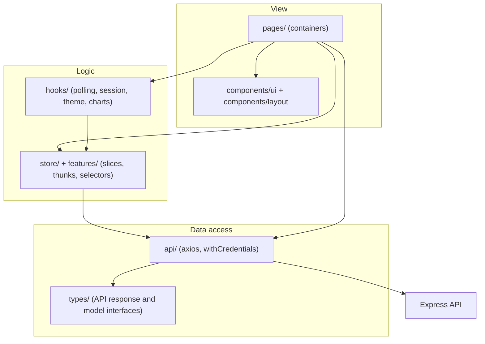
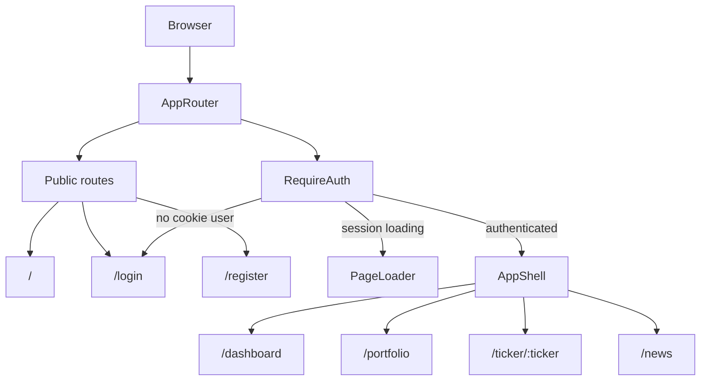
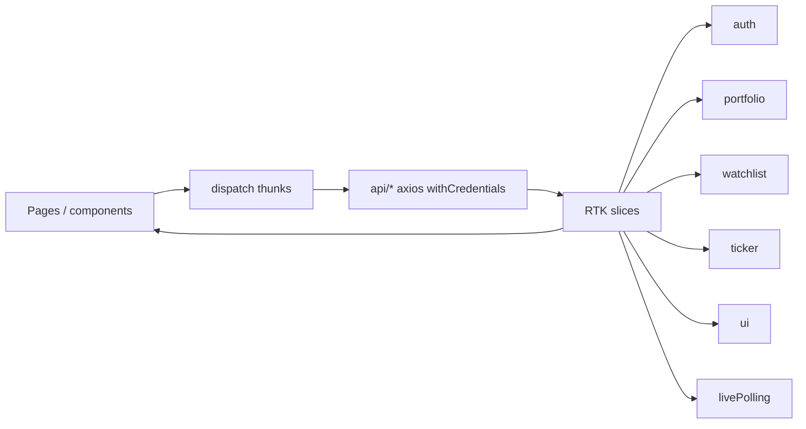
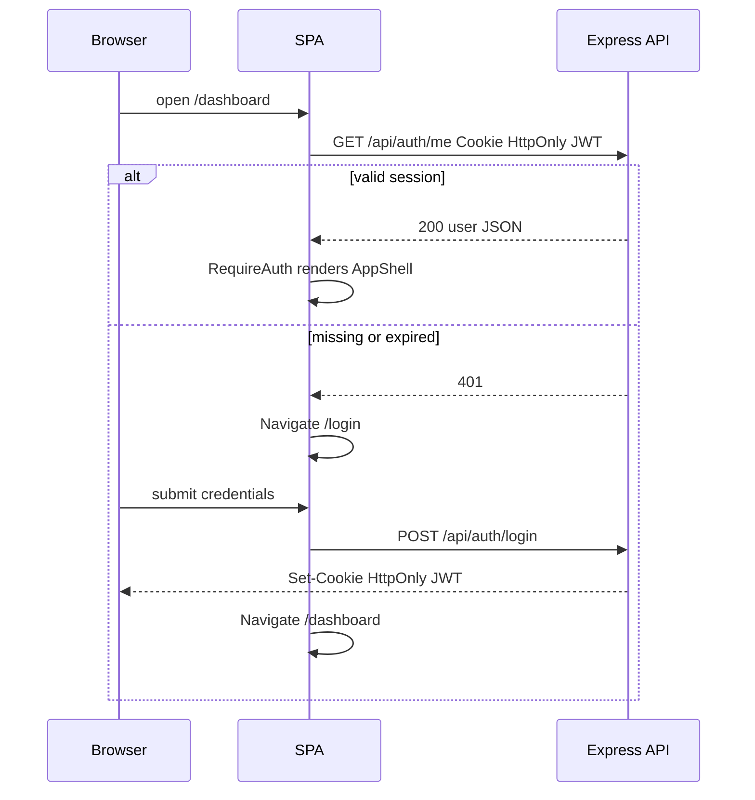
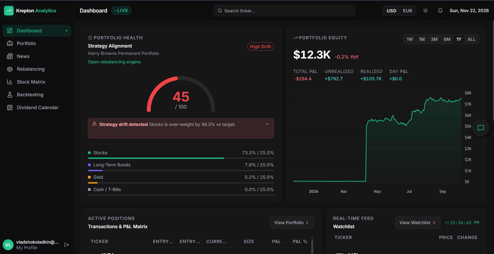
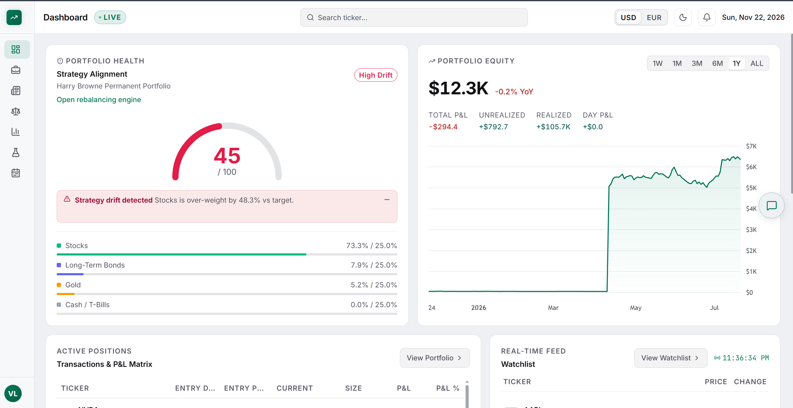
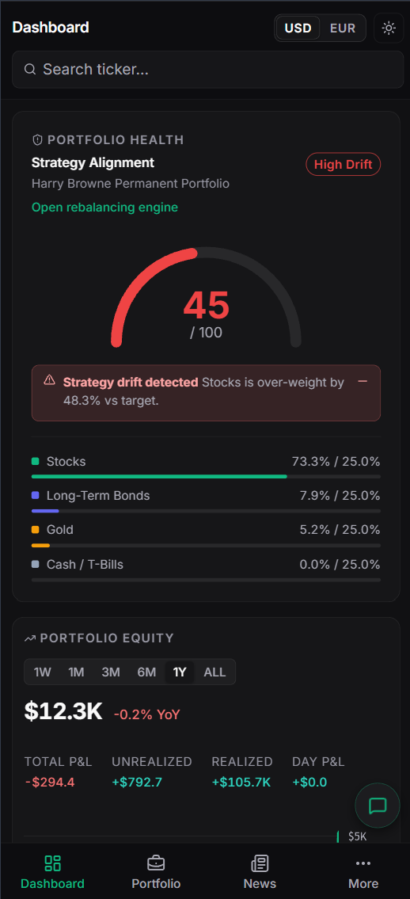
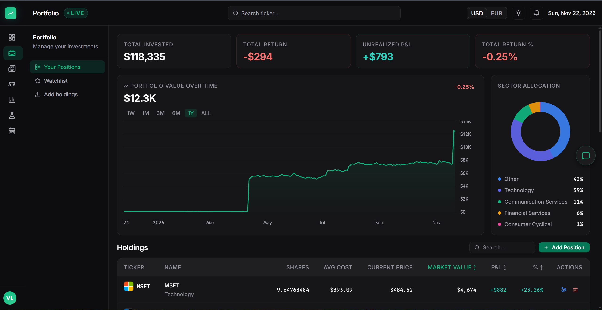
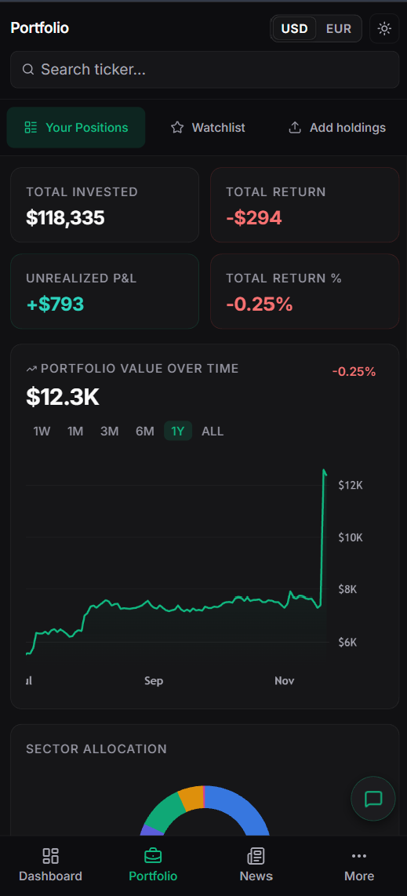
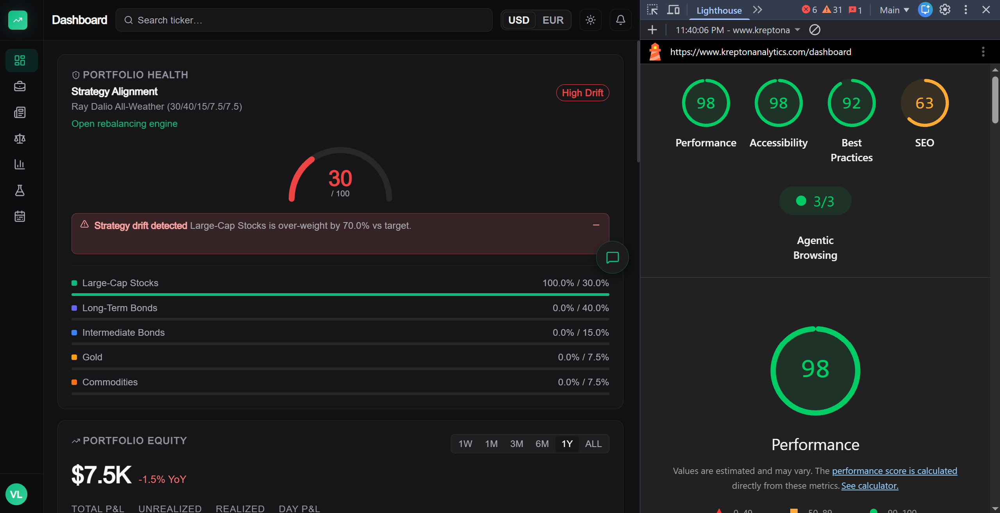

# Criterion: Frontend

## Architecture Decision Record

### Context

Frontend min requires a SPA with routing, global state, forms, lists/filters, responsive layout, error handling, and tests. The UI must talk to the real API with cookie credentials.

### Decision

React 19 + Vite + TypeScript + React Router + Redux Toolkit + SCSS modules. Pages compose; `api/` is the only HTTP layer; tokens never touch `localStorage`.

**Architecture approach.** The UI is component-based: pages (containers) own a screen and compose reusable components from `components/ui` and `components/layout`. Data shared between screens follows the Flux pattern through Redux Toolkit: a component dispatches a thunk, the thunk calls `api/`, a slice stores the result, and selectors feed the components back. Behaviour that is not tied to one component (polling, session renewal, theme, chart data) lives in hooks. Screen-local state stays in `useState`.



### Alternatives Considered

| Alternative          | Why not                                               |
| -------------------- | ----------------------------------------------------- |
| Next.js              | SSR not needed; cookie-to-API is simpler as a SPA     |
| LocalStorage JWT     | Forbidden by project security rules                   |
| CSS-in-JS / Tailwind | SCSS modules + tokens already match the design system |
| No global store      | Auth, portfolio, quotes are cross-page                |

## How to open it

The live app is [https://www.kreptonanalytics.com](https://www.kreptonanalytics.com). The API is [https://api.kreptonanalytics.com](https://api.kreptonanalytics.com).

Local frontend, after the API is up (see the repository [README](../../README.md)):

```bash
cd frontend
cp .env.example .env
npm install
npm run dev
```

App: http://localhost:5173. The dev server proxies nothing by itself: `VITE_API_URL` in `frontend/.env` must point at the API (local default `http://localhost:3001`).

```bash
cd frontend
npm test
npm run lint
npm run test:e2e
```

`npm test` is Jest and React Testing Library. `npm run test:e2e` is Playwright (`frontend/e2e/login.spec.ts`) and expects a migrated, seeded API. Details are in `frontend/e2e/README.md`.

## Where to look

| Path                                                    | Contents                                                                                                                            |
| ------------------------------------------------------- | ----------------------------------------------------------------------------------------------------------------------------------- |
| `frontend/src/main.tsx`                                 | Store provider and the 401 handler                                                                                                  |
| `frontend/src/app/App.tsx`                              | `AppErrorBoundary` around the router                                                                                                |
| `frontend/src/router/AppRouter.tsx`                     | Lazy routes and `RequireAuth`                                                                                                       |
| `frontend/src/router/RequireAuth.tsx`                   | Session check via `GET /api/auth/me`                                                                                                |
| `frontend/src/store/index.ts`                           | The one Redux store                                                                                                                 |
| `frontend/src/features/`                                | Slices: `auth`, `portfolio`, `watchlist`, `ticker`, `ui`, `livePolling`                                                             |
| `frontend/src/features/portfolio/portfolioSelectors.ts` | `selectPortfolioStats` (`createSelector`)                                                                                           |
| `frontend/src/api/apiClient.ts`                         | Axios instance, `withCredentials: true`, 401 interceptor                                                                            |
| `frontend/src/api/*Api.ts`                              | One module per resource: `authApi`, `portfolioApi`, `watchlistApi`, `stockApi`, `importApi`, `fxApi`, `billingApi`, `brokerSyncApi` |
| `frontend/src/utils/apiError.ts`                        | Maps any failed request to an `ApiRequestError` with a user-facing message                                                          |
| `frontend/src/hooks/`                                   | Polling, session, theme, charts, focus trap, card navigation, market-index data/visibility, page SEO                                |
| `frontend/src/types/`                                   | Interfaces for API responses and models                                                                                             |
| `frontend/src/pages/`                                   | One folder per screen                                                                                                               |
| `frontend/src/components/ui/`                           | Custom kit: `Button`, `Input`, `Select`, `Skeleton`                                                                                 |
| `frontend/src/styles/`                                  | Tokens, mixins, light/dark theme                                                                                                    |
| `frontend/src/constants.ts`                             | Routes, copy, and numeric limits                                                                                                    |
| `frontend/e2e/login.spec.ts`                            | End-to-end login                                                                                                                    |

Shared portfolio and auth data goes through thunks. Screen-local actions (password change, import, backtest, chat, billing) call `api/` from the page that owns them.

## Implementation Details

### Project Structure

```
frontend/src/
├── app/           # providers + AppErrorBoundary
├── router/        # lazy routes, RequireAuth
├── pages/         # one folder per screen
├── components/    # ui kit + layout
├── features/      # Redux slices and selectors
├── store/
├── api/           # axios, withCredentials
├── hooks/
├── types/
├── styles/        # tokens, mixins
└── constants.ts
```

Quotes are not loaded in the browser from Yahoo. The SPA asks the Express API. Live quotes on the dashboard and the watchlist are refreshed by polling (`useHoldingsPolling`, `useWatchlistPolling`).

### Key Implementation Decisions

| Decision                               | Rationale                                                                                 |
| -------------------------------------- | ----------------------------------------------------------------------------------------- |
| RTK + local useState                   | Shared data in the store; dialog and form state stays on the screen                       |
| `createSelector` for portfolio stats   | Dashboard reads a stable stats object                                                     |
| `Skeleton` + `AsyncStatePanel`         | Page and list fetches use layout placeholders; button and search mutations keep a spinner |
| `ContentSkeleton` owns `role="status"` | One announcement per pending fetch                                                        |
| `LOADING_MESSAGES` in `constants.ts`   | The same string is the accessible name and the visible label                              |
| SCSS modules                           | Component styles stay next to the component                                               |
| `withCredentials: true`                | Cookie session                                                                            |
| Central axios + error boundary         | HTTP errors and render crashes both have UI                                               |

### Routes and navigation

Public: `/`, `/pricing`, `/security`, `/login`, `/register`, email verification, and password reset.

After `RequireAuth`: `/dashboard`, `/portfolio`, `/rebalancing`, `/screener`, `/backtesting`, `/dividends`, `/news`, `/ticker/:ticker`, `/profile`, `/subscription`.



### Redux slices



### Cookie session



JWT never enters `localStorage`. Axios uses `withCredentials: true`. Render crashes are caught by `AppErrorBoundary` (fallback + `console.error`), not a white screen.

### API the client works with

The contract is [`backend/openapi.yaml`](../../backend/openapi.yaml); the [API reference](../backend/api-reference.md) summarises it. The frontend reaches it only through `frontend/src/api/`. Every success body is `{ "success": true, "data": ... }` and every failure is `{ "success": false, "error": "..." }` with a real HTTP status. Response interfaces live in `frontend/src/types/`.

| Client module                          | Endpoints                                                                                                                                                                                                                                    |
| -------------------------------------- | -------------------------------------------------------------------------------------------------------------------------------------------------------------------------------------------------------------------------------------------- |
| `authApi`                              | `POST /api/auth/login`, `register`, `google`, `logout`; `GET /api/auth/me`; `POST /api/auth/extend`; `PATCH /api/auth/ai-personal-data`; password reset and email verification                                                               |
| `portfolioApi`                         | `GET/POST /api/portfolio`, `PATCH/DELETE /api/portfolio/{positionId}`, `GET /api/portfolio/transactions`, `investment-summary`, `equity-history`, `rebalancing`, `dividends`, `news`; AI: `news/summary`, `ticker-chat`, `ticker-chat/quota` |
| `watchlistApi`                         | `GET/POST /api/portfolio/watchlist`, `DELETE /api/portfolio/watchlist/{itemId}`                                                                                                                                                              |
| `stockApi`                             | `/api/stocks/*`: quote, search, history, ticker tape, movers, asset-class                                                                                                                                                                    |
| `importApi`                            | `POST /api/portfolio/import/preview` (multipart, parsed in memory)                                                                                                                                                                           |
| `fxApi`, `billingApi`, `brokerSyncApi` | `/api/fx/*`, `/api/billing/*`, broker sync                                                                                                                                                                                                   |

Example: add a position.

```http
POST /api/portfolio
Content-Type: application/json
Cookie: accessToken=<HttpOnly JWT, sent by the browser>

{ "ticker": "AAPL", "companyName": "Apple Inc.", "shares": 4, "avgBuyPrice": 125.5, "currency": "USD" }
```

```json
{
  "success": true,
  "data": {
    "id": "6b0c7a0e-2b53-4f0e-9f0e-0b2b1c5d9a11",
    "ticker": "AAPL",
    "companyName": "Apple Inc.",
    "shares": 4,
    "avgBuyPrice": 125.5,
    "currency": "USD",
    "sector": "Technology",
    "entryDate": null,
    "includedInAnalysis": true,
    "createdAt": "2026-11-24T16:34:54.866Z",
    "updatedAt": "2026-11-24T16:34:54.866Z"
  }
}
```

The backend CI job `backend-db` replays these flows against the specification, so the examples and the OpenAPI file cannot drift apart unnoticed (see [Automated tests](../automated-tests/README.md)).

### Error handling

Every Axios failure passes the response interceptor in `apiClient.ts`, then `toApiRequestError` in `utils/apiError.ts`. The result is an `ApiRequestError` with a `kind` (`network`, `timeout`, `client`, `server`) and a message that is safe to show. The backend message is used for 4xx responses; 5xx responses always show a generic server message.

| Situation                                            | What the user sees                                                           | Where handled                                                                                |
| ---------------------------------------------------- | ---------------------------------------------------------------------------- | -------------------------------------------------------------------------------------------- |
| 401 on a signed-in session                           | The Redux auth state is cleared and `RequireAuth` sends the user to `/login` | Interceptor calls `notifyUnauthorized`; the handler in `main.tsx` runs `expireClientSession` |
| 401 on `/api/auth/login` and other public auth calls | The form shows the error; no redirect                                        | `PUBLIC_AUTH_API_PATH_MARKERS` in `constants.ts`                                             |
| 403                                                  | "Forbidden" message                                                          | `getStatusFallback`                                                                          |
| 404                                                  | "Not found" message                                                          | `getStatusFallback`                                                                          |
| 409                                                  | Conflict message (for example a duplicate watchlist ticker)                  | `getStatusFallback`                                                                          |
| 429                                                  | Rate-limit message                                                           | `getStatusFallback`                                                                          |
| 500, 502, 503, 504                                   | Generic server message                                                       | `getStatusFallback`                                                                          |
| No response / timeout                                | Network or timeout message                                                   | `classifyErrorKind`                                                                          |
| Render crash                                         | Fallback screen and `console.error`                                          | `AppErrorBoundary`                                                                           |

Messages appear in `ErrorBanner` (inline) or next to the field that caused them. Loading states use `Skeleton` and `AsyncStatePanel`.

### Responsive layout

Breakpoints are tokens in `frontend/src/styles/_mixins.scss`: `sm` 480 px, `md` 768 px, `lg` 1024 px, `xl` 1280 px. The mixins `mobile` (below 768 px), `tablet` (below 1024 px), `tablet-up`, and `desktop-up` are the only place media queries are written, so components never hard-code a width. The app content area also uses a container query (`app-content`), which lets a screen react to the space beside the open AI chat drawer rather than to the window. Below 768 px the main navigation becomes a bottom bar (`AppBottomNav`, 48 px tap targets); at wider sizes it is hidden.

### Dashboard cards

| Piece                                                                                                 | Where                                                                                                                   |
| ----------------------------------------------------------------------------------------------------- | ----------------------------------------------------------------------------------------------------------------------- |
| Index cards (level, today's move, one-month line)                                                     | `pages/DashboardPage/components/MarketIndexCard`, `MarketIndicesRow`                                                    |
| Index data (quotes and daily history from the existing API, refreshed every 5 minutes)                | `hooks/useMarketIndexData.ts`                                                                                           |
| Index list and defaults                                                                               | `DASHBOARD_MARKET_INDICES` in `constants.ts`                                                                            |
| Desktop arrange mode (pencil → minus to hide, drag to reorder; list button opens the checkbox dialog) | `MarketIndicesRow`, `hooks/useMarketIndexVisibility.ts`                                                                 |
| Mobile: pencil opens the dialog; index row sits above News                                            | `DashboardPage.module.scss` (`order` under `mobile`)                                                                    |
| Saved visibility and order (this browser; survives refresh and re-login)                              | `utils/marketIndexVisibilityStorage.ts`, key `DASHBOARD_MARKET_INDICES_LAYOUT_STORAGE_KEY`                              |
| Index ticker page (level without `$`, no EUR conversion)                                              | `isMarketIndexTicker` in `utils/tickerRoute.ts`, `utils/indexLevelDisplay.ts`                                           |
| Whole-card click                                                                                      | `hooks/useCardNavigation.ts`: ignores buttons, links, charts, text selection, double clicks, and viewports below 768 px |
| Corner arrow link (keyboard and screen reader entry)                                                  | `components/CardCornerLink`                                                                                             |

The saved layout holds only display preferences in `localStorage`.

### Asset-class badges on the ticker page

| Piece                         | Where                                                |
| ----------------------------- | ---------------------------------------------------- |
| Colored badges + basis dialog | `pages/TickerDetailPage/components/AssetClassBadges` |
| API client                    | `fetchStockAssetClass` in `api/stockApi.ts`          |
| Badge colors                  | `ASSET_CLASS_BADGE_COLORS` in `constants.ts`         |

Badges appear only when `GET /api/stocks/asset-class/:ticker` returns explicit evidence. Empty list or request failure shows nothing.

### Stock Matrix market movers

On `/screener`, `MarketMoversPanel` lists Yahoo gainers and losers. Each ticker name is a link to `/ticker/:ticker`. The `+` button still only adds the symbol to the comparison matrix.

### AI chat drawer

The chat is one drawer that follows the user across screens. The drawer is a container; its parts are separate components.

| File                          | Role                                                                                     |
| ----------------------------- | ---------------------------------------------------------------------------------------- |
| `TickerChatDrawer.tsx`        | Container: quota, send, **New chat**, **Previous chat**, open/close                      |
| `TickerChatMessageList.tsx`   | Messages with markdown, quote strip, and chart card                                      |
| `ChatTickerChartCard.tsx`     | Price chart inside a reply when the question names a ticker that is not on the open page |
| `TickerChatComposer.tsx`      | Input and the **Share my portfolio data with this chat** checkbox                        |
| `TickerChatSuggestions.tsx`   | Suggestion chips for the open screen                                                     |
| `tickerChatDrawer.helpers.ts` | Builds the screen context and trims the history sent to the API                          |
| `utils/tickerChatSession.ts`  | Thread storage in `sessionStorage`, including archived threads                           |

Rules the code follows:

- History stays in the browser tab. The request carries only the newest 6 turns (4000 characters per turn, 6000 in total); the same limits are enforced again on the server.
- **New chat** moves the current thread into an archive of at most 2 threads. **Previous chat** brings the newest archived thread back. Logout or closing the tab clears everything.
- Sharing portfolio data has two switches. The profile switch (`PATCH /api/auth/ai-personal-data`, stored as `users.ai_personal_data_enabled`, on by default) is enforced by the server. The chat checkbox sets `includeHoldingContext` per request and is disabled while the profile switch is off.
- The server, not the browser, resolves tickers named in a question and attaches fresh quotes. The browser only draws the chart when the reply names a `chartTicker`.

## Screenshots

Captured on the production site, 2026-11-22. Desktop frames are a wide window. Mobile frames are a phone-width layout. The gauge on the dashboard is the strategy alignment score, not a Lighthouse score.

### Landing


### Dashboard







### Portfolio





### Lighthouse

Chrome Lighthouse on [https://www.kreptonanalytics.com/dashboard](https://www.kreptonanalytics.com/dashboard), 2026-11-22. Performance 98, Accessibility 98, Best Practices 92.



## Files in this folder

| Path                           | Contents                                                     |
| ------------------------------ | ------------------------------------------------------------ |
| [screenshots/](./screenshots/) | Desktop, phone, and Lighthouse screenshots used on this page |

## Requirements Checklist

| #   | Requirement                                                  | Status | Evidence                                                                                                                             |
| --- | ------------------------------------------------------------ | ------ | ------------------------------------------------------------------------------------------------------------------------------------ |
| 1   | SPA + modern framework                                       | ✅     | React 19 + Vite                                                                                                                      |
| 2   | Architecture diagram / stack justification                   | ✅     | This file + [tech-stack](../thesis/docs/02-technical/tech-stack.md)                                                                  |
| 3   | 3–4+ routes                                                  | ✅     | `frontend/src/router/AppRouter.tsx`                                                                                                  |
| 4   | Global state                                                 | ✅     | Redux Toolkit, `frontend/src/store/index.ts`                                                                                         |
| 5   | Typed API client                                             | ✅     | TypeScript + `frontend/src/api/`                                                                                                     |
| 6   | Forms + validation, lists, filter/search                     | ✅     | Auth, portfolio holdings, screener                                                                                                   |
| 7   | Responsive desktop + mobile                                  | ✅     | Landing, dashboard, and portfolio screenshots above                                                                                  |
| 8   | ESLint + Prettier                                            | ✅     | `frontend` scripts `lint`, `format:check`                                                                                            |
| 9   | Global errors + user-visible messages; 401/403/404/500       | ✅     | Axios interceptor, `toApiRequestError`, `ErrorBanner`, `AppErrorBoundary`; status table in [Error handling](#error-handling)         |
| 10  | Skeleton/loading on async fetches                            | ✅     | `Skeleton`, `AsyncStatePanel`; search and auth keep a button spinner                                                                 |
| 11  | Unit tests ≥ 3 components + 1–2 e2e                          | ✅     | Jest + React Testing Library, 483 tests in 135 suites, 80% coverage gate (86.8% statements); Playwright `frontend/e2e/login.spec.ts` |
| 12  | No tokens in code                                            | ✅     | HttpOnly cookie; `localStorage` holds theme and UI preferences only                                                                  |
| 13  | Max: lazy routes + RTK + charts/theme                        | ✅     | Lazy routes, Redux Toolkit, charts, light/dark theme                                                                                 |
| 14  | Max: performance evidence                                    | ✅     | Production dashboard Lighthouse: Performance 98 (2026-11-22)                                                                         |
| 15  | Max: accessibility check                                     | ✅     | Contrast, landmarks, labels, headings, keyboard pass. Lighthouse Accessibility 98 on the same report                                 |
| 16  | Architecture approach, layers, API documentation, user flows | ✅     | Layer diagram above, [API the client works with](#api-the-client-works-with), route and cookie-session diagrams                      |

## References

- `frontend/src/router`, `frontend/src/store`, `frontend/src/api`, `frontend/src/app/AppErrorBoundary.tsx`
- Repository [README](../../README.md) for the local API, database, and demo seed
